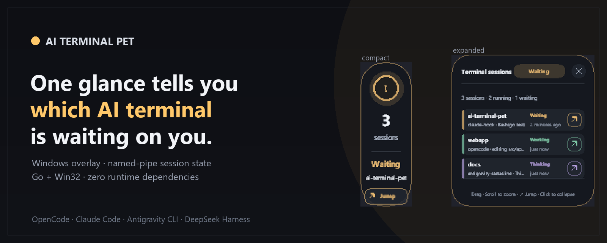
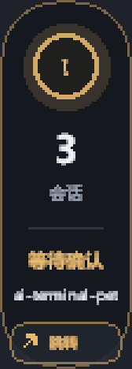
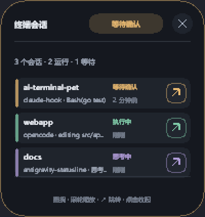
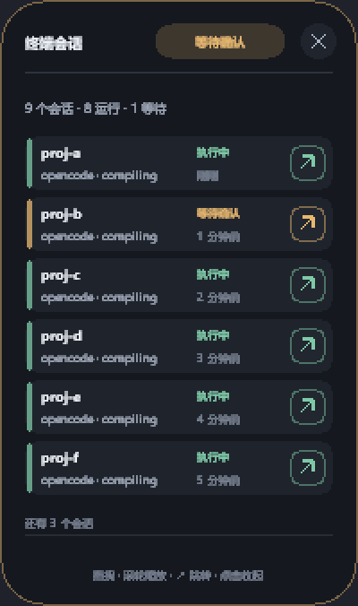
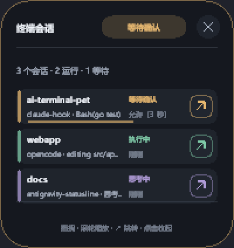

# ai-terminal-pet

Stop glancing across terminal windows to track agent states. It costs one small executable with no account and no cloud.



  
   

> 🇬🇧 [English](#english) &nbsp;·&nbsp; 🇨🇳 [中文](#中文)

---

## English

### The problem

You run Claude Code, OpenCode, or Antigravity in multiple terminal windows at once. A background task prompts for permission to execute a tool, but you are focused in another window and never notice the prompt.

Fourteen minutes later, you switch back only to discover that your build has been sitting idle the entire time. Glancing across multiple terminal tabs wastes focus and breaks your concentration.

ai-terminal-pet anchors a 56px strip to the screen edge. It aggregates your sessions in real time, pulses when an agent needs permission, and displays which project is waiting and for how long.

The table below contrasts the everyday workflow before and after using the overlay:

| Context | Before | After |
|---|---|---|
| Multiple terminals | Four terminal windows open; you lose track of which window needs attention. | One 56px strip on the edge of the screen aggregates every active session. |
| Blocked build | You find out a build was blocked on a permission prompt fourteen minutes ago. | The overlay pulses immediately and shows which project is waiting and for how long. |
| Context switching | You click across tabs to check whether builds and tasks are still running. | A single glance reveals current states without touching your keyboard or mouse. |

### What it looks like


*Compact strip: pulsing state orb with status glyph, session count, state word, and waiting project name.*


*Expanded list: active sessions showing per-row project name, state, source hook, and relative time.*


*Expanded list with many sessions: six session rows followed by the overflow line showing remaining sessions.*


*Auto-approve countdown: draining bar with "Allow (5s)" prompt allowing manual veto before automatic permission approval.*

---

### Features

The table below outlines the core capabilities and exact runtime parameters of the application:

| Feature | What it actually does |
|---|---|
| State aggregation | Aggregates sessions across 7 states (`idle`, `thinking`, `working`, `tool_use`, `waiting_permission`, `error`, `closed`), showing the highest-priority state across all active sessions. |
| Compact and expanded panels | Compact panel occupies 56x156 logical pixels anchored to a screen edge; clicking expands to 200 px wide, displaying 1–6 rows before adding an overflow line. |
| Whole-panel gestures | Click anywhere toggles compact and expanded views, drag anywhere moves 1:1 with the cursor, and mouse wheel adjusts zoom between 65% and 160%. |
| Edge retract | Slides mostly off-screen when docked at an edge leaving a thin sliver; hovering restores it, while waiting_permission or error states override retraction to remain visible. |
| Tray menu | Right-click tray menu toggles visibility, resets position and zoom, opens settings, switches language, toggles autostart, and configures auto-approve. |
| Settings window | Native three-tab window (General, Sound, Sessions) where every change persists immediately to `config.json` without an OK button. |
| Synthesized alert tones | Generates 44.1 kHz 16-bit mono PCM WAV tones in memory across four sound schemes (`chime`, `bell`, `soft`, `pulse`), with separate gates for waiting, error, and finish. |
| Per-session alerts | Fires Windows tray notification balloons and audio alerts on transitions into `waiting_permission`, `error`, or finish states. |
| Auto-approve and denylist | Provides a 5-second veto window on permission prompts where a tap denies and silence approves; blocks commands matching the dangerous-command denylist. |
| Jump to terminal | Walks session process ancestry and matches window titles to bring the waiting terminal window or tab to the foreground. |
| Scriptable CLI | Outputs structured session state via `ai-terminal-pet --json` by reading disk snapshots, avoiding blocking on GUI processes. |
| Single instance | A named mutex makes a second launch activate the running overlay instead of starting another one. |
| Connection capacity | The pipe server accepts 32 concurrent connections with a 5 s read timeout, so IPC never blocks the UI thread. |
| Idle lifecycle | A session is dropped only after a 2-minute absence grace; with no session left, the process removes itself after 10 minutes. |

### How it works

```text
Host CLI (Claude Code / OpenCode / Antigravity)
       │
       ▼ (Fire-and-forget hooks)
reporters/*.js
       │
       ▼ (JSON line over Windows named pipe: \\.\pipe\ai-terminal-pet-v1-<8hex>)
AI-Terminal-Pet.exe (Go 1.23, single-instance mutex)
       │
       ├─► internal/pipeserver (32 connections, 5s timeout, OK/ERR response)
       ├─► internal/store (in-memory state, TTL, disk snapshots fallback)
       └─► internal/ui (Win32 layered window, GDI topmost canvas)
```

- **Per-user named pipe**: IPC flows through `\\.\pipe\ai-terminal-pet-v1-<8hex>`, where `<8hex>` is derived from the SHA-256 hash of the user home directory. The exact same pipe-name algorithm is implemented in Go and JavaScript, locked by a cross-language golden test.

- **JSON line protocol**: Sessions transmit one JSON line per message with a 1 MiB payload cap. The server replies with an exact `OK` or `ERR` acknowledgment, and reporters retry until a deadline without treating partial reads as success.

- **On-disk snapshots**: Snapshot files under `%LOCALAPPDATA%\AI-Terminal-Pet\runtime\` provide a fallback channel and serve as the authoritative on-disk record of active sessions.

- **OS observation over heartbeats**: Session existence is decided by operating system observation of the process table and window titles rather than reporter heartbeats. A session remains active as long as its terminal window exists, and removal requires the host to be unobservable for a continuous 2-minute grace period.

- **Disks beat heartbeats**: The disk snapshot is authoritative for session existence: a session that was on disk and is gone is over, while synthetic PIDs from hooks never participate in liveness probing.

- **Connection handling**: The server accommodates 32 concurrent connections with a 5s read timeout, keeping IPC processing off the UI thread.

- **GDI rendering**: A top-down 32bpp DIB section created with CreateDIBSection is painted through a memory DC and handed to the layered window with UpdateLayeredWindow.

### Install

Installation takes about 30 seconds on Windows using PowerShell:

1. Build both executables:
   ```powershell
   go build -trimpath -buildvcs=false -ldflags "-s -w" -o .\bin\AI-Terminal-Pet.exe ./cmd/ai-terminal-pet
   go build -trimpath -buildvcs=false -ldflags "-s -w" -o .\bin\pet-statusline.exe ./cmd/pet-statusline
   ```

2. Run the installer to copy binaries and sync assets:
   ```powershell
   .\install.ps1
   ```

3. Verify that the installation works:
   ```powershell
   & "$env:LOCALAPPDATA\AI-Terminal-Pet\AI-Terminal-Pet.exe" --json
   ```
4. Re-verify the installed artifacts at any time with per-file SHA256 checks:
   ```powershell
   .\install.ps1 -VerifyOnly
   ```
   It prints `install: verified - 10 file(s) match the repository, 0 warning(s)` and exits 0 only when every deployed artifact matches (the 10 artifacts are the overlay, the statusline shim, `protocol.js`, and the 7 files of the DeepSeek Harness bundle).
   The installer itself stops a running overlay first and waits for the process to release its file handles; a plain file copy over a live binary fails at random, which is what the retry loop and the SHA256 comparison after every copy are for.
5. Optional — put `ai-terminal-pet` on your PATH so you can type the bare command:
   ```powershell
   .\install.ps1 -AddToPath
   ```
   It writes **only** `HKCU\Environment\Path` (never `HKLM`), backs the previous value up to `<install dir>\path-backup.txt` first, and does nothing if the directory is already listed. **Open a new terminal** for the change to take effect. `-Uninstall` also removes that PATH entry, so uninstalling does not leave a dead entry behind (the previous value is backed up again, this time into `%TEMP%`).
   Without this step the installer does not touch your PATH at all, so keep using the full path `& "$env:LOCALAPPDATA\AI-Terminal-Pet\AI-Terminal-Pet.exe" --json`.

Run `ai-terminal-pet --doctor` at any point after installing to self-check the environment, install files, runtime state, pipe, autostart entry, and node availability. To remove the deployed artifacts, run `.\install.ps1 -Uninstall`; it asks for a typed `yes` confirmation first, refuses unsafe target directories, and accepts `-Force` for unattended removal.

Installing a terminal hook is required for that terminal to report; see the next section to connect your tools.

### Connect your terminal

| Terminal | How to connect | What you get |
|---|---|---|
| OpenCode | Add `file:///C:/path/to/ai-terminal-pet/reporters/opencode.js` to `plugin` in `opencode.json` | Automatic session tracking for tool use, prompt handling, and task completion |
| Claude Code | Add `node <repo>/reporters/claude-hook.js` for `SessionStart`, `SessionEnd`, `UserPromptSubmit`, `PreToolUse`, `PostToolUse`, `Stop`, and `Notification` in `settings.json` | Real-time status updates, tool execution tracking, and permission prompt alerts |
| Antigravity | Set `statusLine.command` to `pet-statusline.exe` and configure `antigravity-hook.js` for agent and tool events | Fast statusline updates, agent state changes, and permission request forwarding |
| DeepSeek Harness | Install the Cordis bundle from `%LOCALAPPDATA%\AI-Terminal-Pet\bundles\ai-terminal-pet-bridge\` via the plugin manager (`install_bundle`) | turn/start to working, tool/call to tool_use, approval/asked to waiting_permission, tool/result with an error to error, turn/end to idle, process exit to closed |
| Anything else | Run `node reporters/generic.js` with `--source`, `--state`, and `--project` flags | Instant status reporting from any custom script or CLI tool |

Writing your own reporter for a tool that is not listed here needs no source reading: [docs/PROTOCOL.md](docs/PROTOCOL.md) specifies the wire protocol (fields, state semantics, pipe-name derivation, acknowledgment contract, and redaction rules) that a conforming reporter must implement.

The Harness side is a host-only Cordis bundle: it holds no pipe-name, state-set or snapshot logic of its own, it loads the protocol from `%LOCALAPPDATA%\AI-Terminal-Pet\protocol.js` and delegates everything to it.

The Harness side has a second, self-contained option since `dsh-ai-terminal-pet` `1.1.0`: a standalone DSH plugin package at [`packages/dsh-ai-terminal-pet`](packages/dsh-ai-terminal-pet), also shipped as a GitHub Release asset. The package is now **1.2.0** (tag `dsh-plugin-v1.2.0`, asset `dsh-ai-terminal-pet-1.2.0.tgz`); 1.1.0 stays published and immutable but is superseded, because 1.2.0 changed what the manifests declare and re-shipping changed content under an unchanged version is exactly the drift this repository removes. Three install forms are verified end to end (the timings were taken on the 1.1.0 assets; the 1.2.0 assets sit at the same URLs with only the tag and version changed; a bare `add dsh-ai-terminal-pet` waits on the npm release described below):

```powershell
# from the release tarball: no git clone, no build step
dsh plugin --profile <profile> add https://github.com/jjjjjjjjnnjnn/ai-terminal-pet/releases/download/dsh-plugin-v1.2.0/dsh-ai-terminal-pet-1.2.0.tgz

# from git, pinned to the release tag
dsh plugin --profile <profile> add "git+https://github.com/jjjjjjjjnnjnn/ai-terminal-pet.git#dsh-plugin-v1.2.0&path:/packages/dsh-ai-terminal-pet"

# from the repository URL: resolves through the root manifest shim
dsh plugin --profile <profile> add github:jjjjjjjjnnjnn/ai-terminal-pet
```

The repository URL works because the repository root now carries a 59-line `package.json` shim that contains no code: it points `main` at the package, declares `dsh.bundle.patch` as `./packages/dsh-ai-terminal-pet/cordis.patch.yml` and limits `files` to that subtree. Without it a host that reads the repository root sees no `dsh.bundle`, installs an empty package and warns `declares no dsh.bundle`. The shim is `private`, so it never occupies the npm name, its `version` tracks the package (`verify.mjs` asserts they are equal, so a bump cannot land in one manifest only), and it carries the same `dsh.catalog` block the package does.

The package ships no lifecycle hooks at all — `prepack` was removed in 1.1.0 — because pnpm runs them for a git dependency and fails an unpinned source with an `allowBuilds` error that never mentions AI Terminal Pet. `vendor/` is committed instead and only verified: `node scripts/vendor.mjs --check` re-hashes the two vendored files and checks `vendor/manifest.json` against them, writing nothing. One form still fails, for a different reason: `git+https://github.com/jjjjjjjjnnjnn/ai-terminal-pet.git&path:/packages/dsh-ai-terminal-pet` without a `#ref` — pnpm concatenates the fragments and asks `ls-remote` for a repository that does not exist, so it reports `repository ... not found`.

1.2.0 also makes the package self-describing: `dsh.catalog` declares a `category` (`tool`), a one-line summary in English and Chinese, and five `capabilities` — `windows-overlay`, `named-pipe`, `session-state`, `tray-icon`, `no-network`. Those capabilities are **self-declared and unenforced**; dsh does not sandbox plugins, so the block describes what the overlay already does rather than granting it permission to do so. `keywords` gained `dsh-plugin`, the tag auto-indexing marketplaces harvest: that makes two independent discovery paths — registry review (a reviewed entry merges into `main` and only then appears in the list) and topic/keyword harvesting (no application needed at all). Two marketplaces already harvest automatically: [LivXue/dsh-plugin-shop](https://github.com/LivXue/dsh-plugin-shop) rebuilds daily from npm metadata, and every entry in its published shard is pinned by tarball integrity, so a Git-only package cannot appear there until it reaches npm; [zasenjc/dsh-plugins-store](https://github.com/zasenjc/dsh-plugins-store) syncs every 30 minutes and lists any public repository carrying both the `dsh-plugin` and `deepseek-harness` topics.

Its payload carries a prebuilt overlay and the official `protocol.js`, copied into `%LOCALAPPDATA%\AI-Terminal-Pet\` on first use **only when they are missing** — an existing install is never overwritten, and the overlay keeps running entirely on its own, so a machine that only wants the pet still needs nothing but `install.ps1`. Its entry in the [awesome-dsh-plugin](https://github.com/awesome-dsh-plugin/awesome-dsh-plugin) registry ([PR #13937](https://github.com/awesome-dsh-plugin/awesome-dsh-plugin/pull/13937)) passed both upstream checks and is waiting on a human reviewer, so it is not listed yet. The [DSH-Plugins-Marketplace](https://github.com/bradeGithub/DSH-Plugins-Marketplace) index already picked this repository up automatically, but its current data still says `verdict: script` / `risk_tier: risk`: the repository now satisfies its bundle rule (the root manifest declares `dsh.bundle.patch`), and that verdict only changes when its next index build finishes. The DSH in-app Discover index accepts an npm version or a git source pinned to a 40-character commit; the npm **credential** problem is resolved (`npm whoami` answers `jjjjjjjjnnjnn` and the name is still free, `npm view` returns E404), but `1.2.0` is **not published yet**, which is why installing by bare package name (`dsh plugin --profile <profile> add dsh-ai-terminal-pet`) does not resolve yet.

Because the plugin index format accepts a git source pinned to a commit, this repository also publishes its own index, so Discover works before npm does. Add this URL once in DSH under Plugins → Discover → index sources:

```text
https://raw.githubusercontent.com/jjjjjjjjnnjnn/ai-terminal-pet/main/docs/market-index.json
```

[`docs/market-index.json`](docs/market-index.json) is one entry, `dsh-ai-terminal-pet` `1.2.0`, whose install spec is the same `git+…#4d777e3…&path:/packages/dsh-ai-terminal-pet` that was installed end to end in 2.5 s above. It is validated with the host's own `parseMarketIndex` from `@deepseek-ai/dsh-plugin-market-index` — `format: 1`, `en` localized text, declared category and label ids, an https icon pinned to the release commit, and an exact SemVer with a Unix-seconds `publishTimestamp`. When npm publishing is unblocked the same file gains an `npm` source for the next version.

Run `node reporters/generic.js` directly to report from any other CLI or script:

```powershell
node reporters/generic.js --source=aider --state=working --project="$PWD"
node reporters/generic.js --source=codex --state=waiting_permission --reason=approve
echo '{"state":"error","reason":"build failed"}' | node reporters/generic.js --source=ci --stdin
```

- `--source`: sets the reporter identity name.
- `--state`: sets one of the seven official session states.
- `--stdin`: parses a JSON payload piped directly from standard input.

### Control it from a script

The commands below assume `ai-terminal-pet` is on your PATH (install step 5, `.\install.ps1 -AddToPath`). If you skipped that step, prefix every command with the full path instead: `& "$env:LOCALAPPDATA\AI-Terminal-Pet\AI-Terminal-Pet.exe" --json`.

| Command | Effect |
|---|---|
| `ai-terminal-pet` | Start the overlay (no-op if already running) |
| `ai-terminal-pet --show` | Reveal the running overlay |
| `ai-terminal-pet --toggle` | Switch between compact and expanded views |
| `ai-terminal-pet --reset` | Re-anchor to the screen edge at 100% zoom |
| `ai-terminal-pet --settings` | Open the settings window |
| `ai-terminal-pet --quit` | Stop the running overlay |
| `ai-terminal-pet --json` | Print the current sessions as JSON (add `--pretty` for formatted output) |
| `ai-terminal-pet --doctor` | Run 9 environment and install checks; exit code 1 when a check fails. Again: needs the install directory on PATH, or call it by full path |
| `ai-terminal-pet --autostart` | Report the run-at-logon state |
| `ai-terminal-pet --autostart=on` | Enable run at logon |
| `ai-terminal-pet --autostart=off` | Disable run at logon |
| `ai-terminal-pet --version` | Print version information |
| `ai-terminal-pet --help` | Print CLI usage help |

Run `--json` to inspect active sessions directly from scripts or shell status lines:

```powershell
ai-terminal-pet --json --pretty
```

```json
{
  "schemaVersion": "ai-terminal-pet.v1",
  "state": "waiting_permission",
  "count": 2,
  "generatedAt": "2026-11-09T21:30:00Z",
  "sessions": [{"project": "ai-terminal-pet", "state": "waiting_permission", "source": "claude-hook"}]}
```

The `--json` command never blocks on a GUI process because it reads session snapshots directly from disk.

### Safety

Terminal hooks run inside your development environment, so their boundaries are strict:

- **Fail-fast reporters**: Reporters run fire-and-forget, catch errors internally, and never throw exceptions or block your host CLI. Any reporter failure terminates silently without interrupting user keystrokes or host terminal operations.

- **Auto-approve disabled by default**: The auto-approve feature starts turned off; activating it requires explicit configuration. A terminal hook that cannot read the configuration file automatically defaults to off.

- **Configurable veto window**: When auto-approve is active, permission prompts display a draining bar on the expanded panel; a single tap denies the prompt, while silence approves after the countdown. Ordinary tool calls without permission prompts are never delayed.

- **Dangerous-command denylist**: Destructive commands never auto-approve and always fall back to manual prompts, blocking patterns such as `rm -rf`, `git push --force`, `format C:`, `rd /s`, and `shutdown /s`. A matched command forces manual review in the terminal.

- **Zero network activity**: The application makes no network calls, contains no telemetry, and stores all configuration and runtime snapshots under `%LOCALAPPDATA%\AI-Terminal-Pet\`. No code or logs leave your local machine.

- **Per-user ACL protection**: The named pipe DACL `"D:P(A;;GRGW;;;OW)(A;;GRGW;;;SY)"` grants read/write access to the owner of the pipe and to LocalSystem only, and nothing for any other account on the machine. Other local users therefore cannot connect and cannot occupy the pipe name.

### Known limits

- **Windows only**: The overlay relies directly on Win32 layered windows and Windows named pipes; macOS and Linux are not supported.

- **Process creation overhead**: Antivirus scanning hooks can make each Node.js process launch take roughly 1s; using the native `pet-statusline.exe` shim or adding an AV exclusion for the install folder reduces this latency. The delay comes from process scanning rather than application code.

- **Named-pipe squatting**: Same-user pipe preemption is mitigated by acquiring a named mutex first, but it is not completely eliminated. A full challenge-response handshake remains documented for future hardening.

- **Auto-approve countdown restart**: Changing the auto-approve countdown duration requires an overlay restart, while all other settings hot-reload automatically.

- **No pixel regression tests**: Pure UI logic, hit testing, and layout bounding boxes are unit-tested, but automated visual pixel regression testing is not in place. Visual verification relies on the PNG preview generator.

- **Window focus granularity**: Session jump focusing resolves tabs in Windows Terminal, but classic conhost windows and VS Code integrated terminals resolve only to the parent window level.

### Roadmap

- **Native hook binary**: A unified `pet-hook.exe` executable to eliminate per-event Node.js spawns for Claude Code and Antigravity (planned).

- **Cross-platform support**: Extracting the UI layer behind a presenter interface with Unix domain socket transport for macOS and Linux (not started).

- **Binary size reduction**: Bring the main executable under 2.5 MiB (currently 4.17 MiB) by stripping reflection metadata and dropping unused packages, and replace the regexp-based redaction in pet-statusline with a hand-written scanner.

Shipped after v0.9.0: the wire protocol specification ([docs/PROTOCOL.md](docs/PROTOCOL.md)) and the `ai-terminal-pet --doctor` self-check command, so both items previously listed here as pending are now available.

Shipped after v0.9.0 as a distribution channel, not just a repository: the Harness bridge is now also a standalone DSH plugin package (`dsh-ai-terminal-pet` 1.2.0, GitHub Release tag `dsh-plugin-v1.2.0`, replacing the superseded 1.1.0). It installs from the release tarball, from git pinned to that tag, or straight from the repository URL through the root manifest shim, and it now describes itself to storefronts through `dsh.catalog`. Its registry entry ([PR #13937](https://github.com/awesome-dsh-plugin/awesome-dsh-plugin/pull/13937)) was merged on 2026-11-10, and the upstream README already lists the entry under "Notifications & Integrations"; the maintainer trimmed one sentence while merging, because for a Harness session the panel only mirrors state and jumps to the Harness window — approvals still happen inside DSH. Merged into `main` is not the same as visible in a market: the catalog page returned 404 when checked at 16:16Z, and `plugins.json`, the file the DSH in-app Market actually loads, still had no entry for this repository at the same time, because the upstream site build has been sitting on its build step. The topic/keyword path needs no application at all, and the DSH-Plugins-Marketplace index still carries the previous `script` verdict until its next rebuild. The DSH in-app Discover index needs an npm release or a commit-pinned git source; npm's credential problem is resolved and publishing 1.2.0 is the next step.

### Non-goals

- No accounts, no cloud sync, no telemetry; everything stays in `%LOCALAPPDATA%`.
- Not a terminal multiplexer and not a replacement for your terminal — it only tells you which session wants attention.

### License

Distributed under the MIT License. See [LICENSE](LICENSE) for details. Third-party dependencies are used as libraries only with zero vendored code: github.com/Microsoft/go-winio (MIT), github.com/lxn/win (BSD-style), and golang.org/x/sys (BSD-style).

### Develop from source

Run verification commands when modifying code:

```powershell
go vet ./...
go test -count=1 ./...
# node --check only validates the FIRST file it is given, so check each one:
for f in reporters/*.js; do node --check "$f"; done
node integrations/deepseek-harness/verify.mjs
$env:PET_PREVIEW_DIR = "$env:TEMP\petpreview"
go test ./internal/ui -run TestRenderPreview
```

`-buildvcs=false` in the two build commands is not decoration: it strips the VCS stamp, which encodes the commit and working-tree state at build time. Two builds of the same source therefore produce identical bytes, on any machine and at any date. Without it a rebuild of `pet-statusline.exe` weighs 3,644,416 B instead of 3,643,392 B, so `.\install.ps1 -VerifyOnly` — which compares the installed files against the copy in your working tree — reports a false failure whenever one side carries the stamp and the other does not. The binaries themselves are not committed (`bin/` is ignored); you always build them locally.

`.\install.ps1 -VerifyOnly` re-checks every installed artifact against the recorded SHA256 list, and `.\install.ps1 -Uninstall` removes them. CI runs the same gates on every push: `.github/workflows/ci.yml` builds on `windows-latest` and fails the job on any `gofmt -l` output, `go vet` finding, failing `go test -count=1 ./...`, unsuccessful `go build -trimpath -buildvcs=false -ldflags "-s -w"` build, any reporter failing its own `node --check`, or failed `node integrations/deepseek-harness/verify.mjs`, `node packages/dsh-ai-terminal-pet/scripts/vendor.mjs --check`, or `node packages/dsh-ai-terminal-pet/verify.mjs`.

---

## 中文

> 本页下方是完整中文版。中文不是英文的逐句直译，而是按中文技术读者的阅读习惯重写。

### 它解决什么问题

日常使用 AI 编程终端时，很多开发者习惯同时开启两三个会话：一个终端运行 Claude Code 重构模块，另一个终端跑 OpenCode 执行测试，第三个终端用 Antigravity 生成文档。

终端在后台自主运行时，你可能会切换到浏览器查阅技术文档，或者在编辑器中编写业务逻辑。然而，AI 终端随时可能因为调用外部工具或执行脚本而暂停，等待你的权限确认。

这类权限提示不会抢占操作系统焦点，也不会主动发出系统通知。四个终端窗口重叠在桌面后台，某个窗口静静等待确认；当你十多分钟后切回终端时，才发现进度早在十四分钟前就已经停滞。

ai-terminal-pet 在屏幕边缘贴上一条 56 像素宽的状态带。你无需来回切换窗口，扫一眼就能看到哪一个项目正在等待确认、当前已经等待了多久。

所有会话正常执行时，面板仅占用极窄的屏幕边沿，贴边收起后只留一条细边；出现等待确认或报错时，浮窗会自动完全展开并脉动提醒；当全部终端关闭后，浮窗在无会话状态下静默等待 10 分钟便会自行退出，不长期占用桌面与后台资源。

### 长什么样

以下截图均由真实的 Win32 渲染引擎在版式测试中直接光栅化生成，与程序运行时的像素布局完全一致：


*紧凑态：展示呼吸脉动的状态球、当前纳管会话总数、最高紧急度的状态词，以及正在等待确认的项目名。*


*展开态：展示全部会话列表，每一行清晰标明项目名、执行状态、终端来源以及距上次活跃的相对时间。*


*会话很多时：超过 6 行后自适应纵向拉长面板，并在列表末尾清晰呈现"还有 N 个会话"溢出行。*


*5 秒否决倒计时：权限请求行展示"允许（5 秒）"倒计时与渐退进度条，在倒计时结束前点击面板即可立即否决。*

---

### 功能

浮窗采用中性石墨底色与低饱和度状态色，所有界面交互遵循"整块可操作"的设计原则，无需刻意瞄准特定微小控件：

| 功能 | 具体行为 |
|---|---|
| 状态聚合 | 聚合 `idle`、`thinking`、`working`、`tool_use`、`waiting_permission`、`error`、`closed` 七种状态，始终展示所有会话中优先级最高的状态。 |
| 紧凑与展开两态 | 紧凑态固定为 56×156 逻辑像素；点击展开后宽度为 200 像素，自适应展示 1–6 行会话，会话超过 6 行后展示溢出提示。 |
| 整块可点可拖 | 面板任意位置点击切换展开/收起，整块区域均可按住拖拽并与光标 1:1 跟随；滚轮可在 65%–160% 之间无级缩放，按 `Esc` 键直接收起。 |
| 贴边收起机制 | 面板贴靠屏幕边缘时自动滑出屏幕并保留细边，鼠标悬停即滑出复原；有会话处于等待确认或出错状态时保持完全可见，不执行收起。 |
| 终端窗口跳转 | 出现需要处理的会话时，点击紧凑态跳转条或展开态行尾箭头，沿进程树与窗口标题匹配并将对应终端窗口置顶；匹配置信度不足时拒绝误切。 |
| 自动同意与否决 | 开启后为权限请求留出默认 5 秒的否决窗口，面板显示"允许（5 秒）"倒计时条；点击面板立即拒绝，倒计时结束仍无操作则自动同意。 |
| 危险命令黑名单 | 自动同意严格校验命令内容，遇到匹配 `rm -rf`、`rd /s`、`git push --force`、`format`、`del ... \Windows` 等规则的高危命令时强制退回人工确认。 |
| 合成提示音方案 | 内存合成 44.1 kHz 16 位单声道 PCM 音效，提供清脆、钟声、柔和、脉冲四套方案；等待确认、出错、完成三种状态可独立设置声音开关。 |
| 逐会话系统通知 | 进入等待确认或出错状态时弹出系统托盘气泡；气泡与提示音共用会话与状态去重逻辑，点击气泡可快速聚焦浮窗。 |
| 托盘与三页设置 | 托盘菜单包含显示隐藏、重置位置、置顶和语言切换；三页设置窗口（通用、声音、会话）调整参数即刻生效，无需点击确认按钮。 |
| 存活判定 | 终端是否还在，靠操作系统观测进程表和窗口标题，不依赖上报端心跳；静默的会话不会被误判成已关闭。 |
| 单实例运行 | 具名互斥体保证第二次启动只是唤醒已经运行的浮窗，不会再起一个进程。 |
| 连接容量 | 管道服务最多接受 32 路并发连接，读超时 5 秒，IPC 不占用 UI 线程。 |
| 空闲生命周期 | 宿主连续 2 分钟不可观测才移除会话；一个会话都不剩时，进程在 10 分钟后自行退出。 |

### 它是怎么工作的

宿主终端与浮窗通过本地 Windows 命名管道进行进程间通信，整体架构如下：

```
AI 编码终端 (Claude Code / OpenCode / Antigravity)
       │
       ▼ (快速失败的上报脚本)
 reporters/*.js ──[命名管道 / JSON-lines]──► AI-Terminal-Pet.exe (Go)
                                                    │
                                                    ├─► 命名管道服务 (32 连接, 5 秒读超时)
                                                    ├─► 会话状态存储 (上限 256 会话)
                                                    ├─► 磁盘快照回退 (%LOCALAPPDATA%)
                                                    └─► Win32 分层浮窗 (GDI 置顶画布)
```

系统核心设计遵循以下原则：

- **按用户隔离的管道路径**：管道名为 `\\.\pipe\ai-terminal-pet-v1-<8hex>`，后缀为当前用户主目录 SHA-256 哈希的前 8 位十六进制字符。Go 端主程序与 JS 上报端各自独立实现哈希计算逻辑，通过跨语言测试严格钉住契约。
- **单行 JSON 与精确回执**：通信采用每行一个独立 JSON 对象（协议版本号 `ai-terminal-pet.v1`），单条数据载荷上限 1 MiB。服务端处理完毕后精确回复 `OK` 或 `ERR`，客户端未收到完整确认前绝不视作成功。
- **系统级存活性观测模型**：会话是否存在由操作系统直接观测决定（扫描系统进程表与终端窗口标题），而非依赖上报端的心跳包。即使终端长时间无状态更新，只要进程或窗口仍在就不会被误判关闭；只有宿主连续 2 分钟在系统中不可观测时才会判定会话结束。
- **权威磁盘证据优先于心跳**：存储在 `%LOCALAPPDATA%\AI-Terminal-Pet\runtime\` 下的快照文件既是管道断开时的回退通道，也是会话存在的落盘证据。磁盘证据的判定优先级高于易失的心跳包，已落盘快照消失即代表该会话正式终结。
- **单实例互斥与按需拉起**：主程序通过具名互斥体保证桌面全局单实例。上报端在发现管道不存在时可按需拉起浮窗，二次启动命令行则会激活已存在的窗口。
- **脏帧跳过与按状态控频**：光栅化模块对实际绘制字段进行哈希签名，前后两帧签名相同时直接跳过底层 GDI 重绘；脉冲动画与滑动动画按需装卸定时器，空闲时完全停止重绘。
- **纯 GDI 内存画布**：用 CreateDIBSection 建立自顶向下的 32bpp DIB，通过内存 DC 绘制，再交给 UpdateLayeredWindow 贴到分层窗口。

### 装起来

本项目仅支持 Windows 平台。打开 PowerShell，按步骤执行构建与安装：

```powershell
# 1. 编译主程序与原生状态栏 shim
go build -trimpath -buildvcs=false -ldflags "-s -w" -o .\bin\AI-Terminal-Pet.exe ./cmd/ai-terminal-pet
go build -trimpath -buildvcs=false -ldflags "-s -w" -o .\bin\pet-statusline.exe ./cmd/pet-statusline

# 2. 安装到系统本地目录并做哈希校验
.\install.ps1

# 3. 验证安装输出（未把安装目录加进 PATH 时用全路径）
& "$env:LOCALAPPDATA\AI-Terminal-Pet\AI-Terminal-Pet.exe" --json

# 4. 随时复核已部署制品（逐项 SHA256 校验）
.\install.ps1 -VerifyOnly

# 5. 可选：把安装目录加进用户 PATH，之后可以只敲 ai-terminal-pet
.\install.ps1 -AddToPath
```

`install.ps1` 在安装时会自动停止正在运行的浮窗，等待系统进程释放文件句柄，并在拷贝后对主程序、状态栏 shim、协议脚本和插件包逐一执行 SHA256 哈希校验。第 4 步的 `-VerifyOnly` 可随时重跑同一份制品清单：全部吻合时打印 `install: verified - 10 file(s) match the repository, 0 warning(s)` 并以 0 退出（10 项 = 主程序 + 状态栏 shim + `protocol.js` + DeepSeek Harness 插件包的 7 个文件）。

第 5 步是可选的：`-AddToPath` 只写 `HKCU\Environment\Path`（绝不碰 `HKLM`），写入前先把原值备份到 `<安装目录>\path-backup.txt`，目录已在 PATH 中时不做任何改动；**改完要新开一个终端**才生效；`-Uninstall` 卸载时会一并移除这条 PATH 记录（原值同样先备份，备份位置改为 `%TEMP%`），不会留下指向已删目录的死条目。不加这个开关时安装脚本不会动 PATH，请继续用全路径 `& "$env:LOCALAPPDATA\AI-Terminal-Pet\AI-Terminal-Pet.exe" --json`。

装完之后随时可以运行 `ai-terminal-pet --doctor` 自检，它会检查运行环境、安装文件、版本、运行期快照与配置、命名管道、实例存在性、node 可用性以及开机自启项共 9 项。需要清理已部署的制品时运行 `.\install.ps1 -Uninstall`，它会先要求输入 `yes` 确认，遇到盘根或非 AI-Terminal-Pet 目录会安全拒绝，无人值守场景可加 `-Force`。

安装完成后浮窗与状态栏 shim 已部署就绪，但终端默认不会自动推送事件；你必须按照下一节的说明，为正在使用的终端环境配置对应的上报端。

### 接入你的终端

上报端脚本均存放在 `reporters/` 目录下，基于 Node.js 标准库编写，零 npm 第三方依赖，通过 `protocol.js` 统一封装通信协议。

各个终端的具体接入方式如下表所示：

| 终端 | 怎么接 | 得到什么 |
|---|---|---|
| OpenCode | 在 `opencode.json` 的 `plugin` 列表中加入 `file:///C:/path/to/ai-terminal-pet/reporters/opencode.js`。修改配置后重启 OpenCode 即可生效。 | 执行中、工具调用、思考中等状态实时上报。 |
| Claude Code | 在 `settings.json` 的 hooks 配置中，为 `SessionStart`、`PreToolUse`、`Stop`、`PermissionRequest` 等挂载 `node <repo>/reporters/claude-hook.js`。 | 权限确认拦截、工具执行状态与 5 秒否决倒计时。 |
| Antigravity | 将 `statusLine.command` 指向 `pet-statusline.exe`，并在事件配置中注册 `antigravity-hook.js`。 | 亚秒级状态栏响应、Agent 思考与权限确认聚合。 |
| DeepSeek Harness | 在官方插件管理器中运行 `install_bundle`，传入 `%LOCALAPPDATA%\AI-Terminal-Pet\bundles\ai-terminal-pet-bridge\` 的绝对路径。 | 真实事件映射：turn/start→working、tool/call→tool_use、approval/asked→waiting_permission、tool/result 出错→error、turn/end→idle、进程退出→closed。 |
| 其他任意 CLI | 在状态变化时调用 `reporters/generic.js`。支持通过命令行参数或标准输入管道传递状态。 | 一行脚本接入任意外部 CLI 或自定义脚本任务。 |

如果要为上面未列出的终端自行编写上报端，无需阅读源码：[docs/PROTOCOL.md](docs/PROTOCOL.md) 完整规定了上报端必须遵守的线协议——字段定义、状态语义、管道名派生规则、`OK`/`ERR` 回执契约与脱敏要求。

Harness 那一侧是 host-only 的 Cordis bundle，自身不含管道名、状态集与快照逻辑，它从 `%LOCALAPPDATA%\AI-Terminal-Pet\protocol.js` 加载协议，全部委托给官方 protocol.js。

自 `dsh-ai-terminal-pet` `1.1.0` 起，Harness 这一侧多了第二种自带电池的接法：独立 DSH 插件包 [`packages/dsh-ai-terminal-pet`](packages/dsh-ai-terminal-pet)，同时以 GitHub Release 资产对外分发。当前版本是 **1.2.0**（tag `dsh-plugin-v1.2.0`，资产 `dsh-ai-terminal-pet-1.2.0.tgz`）；1.1.0 保持已发布、不可变，但已被取代——因为 1.2.0 改动了清单里声明的**内容**，用同一个版本号重新发一份内容不同的包，正是本仓库一直在消除的那种漂移。三种装法都端到端实测通过（计时取在 1.1.0 的资产上；1.2.0 的资产在同一组 URL、只换了 tag 与版本号；不钉源、直接 `add dsh-ai-terminal-pet` 那种要等下面说的 npm 发布）：

```powershell
# 用 Release 资产：不需要 clone，也不需要构建
dsh plugin --profile <profile> add https://github.com/jjjjjjjjnnjnn/ai-terminal-pet/releases/download/dsh-plugin-v1.2.0/dsh-ai-terminal-pet-1.2.0.tgz

# 用 git 源：钉住 Release 的那个 tag
dsh plugin --profile <profile> add "git+https://github.com/jjjjjjjjnnjnn/ai-terminal-pet.git#dsh-plugin-v1.2.0&path:/packages/dsh-ai-terminal-pet"

# 用仓库地址：靠仓库根的清单 shim 解析过去
dsh plugin --profile <profile> add github:jjjjjjjjnnjnn/ai-terminal-pet
```

第三种能成，是因为仓库根现在有一个 59 行、不含任何代码的 `package.json` shim：`main` 指向插件包、`dsh.bundle.patch` 指 `./packages/dsh-ai-terminal-pet/cordis.patch.yml`，`files` 只放行那个子树。没有它，只读仓库根的宿主看不到 `dsh.bundle`，会装出一个空包并提示 `declares no dsh.bundle`；它标了 `private`，不会占用 npm 上的真名，`version` 跟随插件包（`verify.mjs` 断言两者相等，所以版本号不可能只落在一个清单里），并且带着与插件包相同的 `dsh.catalog` 块。

包里没有任何生命周期钩子——`prepack` 在 1.1.0 已被删掉——因为 pnpm 对 git 依赖会执行它，未钉版本的源会因此撞上一条完全没提到 AI Terminal Pet 的 `allowBuilds` 报错。`vendor/` 改为整体提交进仓库，只做校验：`node scripts/vendor.mjs --check` 重新算两个文件的哈希，并拿 `vendor/manifest.json` 与它们比对，同样不写任何东西。还有一条形态会失败，但原因不同：`git+https://github.com/jjjjjjjjnnjnn/ai-terminal-pet.git&path:/packages/dsh-ai-terminal-pet` 不写 `#ref`——pnpm 会把两段直接拼起来，拿一个不存在的仓库地址去 `ls-remote`，于是报 `repository ... not found`。

1.2.0 还让这个包变得「自我描述」：`dsh.catalog` 声明了 `category`（`tool`）、中英各一行摘要，以及五项 `capabilities`——`windows-overlay`、`named-pipe`、`session-state`、`tray-icon`、`no-network`。这些 capabilities 是**自我声明、不被强制**的：dsh 并不对插件做沙箱隔离，所以这一块描述的是浮窗本来就在做的事，不是一份权限授予。`keywords` 里新增了 `dsh-plugin` 这个自动索引型市场会采集的标签，于是现在有两条互相独立的发现路径——注册表评审（条目被合并进 `main` 之后才会出现在列表里）与 topic/关键词采集（完全不需要提交申请）。已有两家市场在自动采集：[LivXue/dsh-plugin-shop](https://github.com/LivXue/dsh-plugin-shop) 每日按 npm 元数据重建，它发布的条目全部以 tarball 完整形哈希钉版本，所以在包进 npm 之前，纯 git 源进不去这家；[zasenjc/dsh-plugins-store](https://github.com/zasenjc/dsh-plugins-store) 每 30 分钟同步，收录同时带 `dsh-plugin` 与 `deepseek-harness` 两个 topic 的公开仓库。

它的载荷自带预编译浮窗与官方 `protocol.js`，首次使用时拷进 `%LOCALAPPDATA%\AI-Terminal-Pet\`，且**只在文件缺失时才拷**——已装的文件绝不覆盖；浮窗本身依旧完全独立运行，只想要浮窗的机器仍然只需要 `install.ps1`。它在 [awesome-dsh-plugin](https://github.com/awesome-dsh-plugin/awesome-dsh-plugin) 注册表的条目（[PR #13937](https://github.com/awesome-dsh-plugin/awesome-dsh-plugin/pull/13937)）已于 2026-11-10 被合并，上游 README 的「Notifications & Integrations」小节已列出这个条目（维护者合并时删掉了原稿里「也能在面板上直接放行审批」一句，因为对 Harness 会话来说面板只做状态映射与跳转，审批仍在 DSH 里完成）。但**合并进 `main` 不等于在某个市场里可见**：16:16Z 复查时条目页仍返回 404，而 DSH 应用内 Market 真正加载的 `plugins.json` 里同样没有本仓库——上游的站点构建一直卡在 build 步骤上。[DSH-Plugins-Marketplace](https://github.com/bradeGithub/DSH-Plugins-Marketplace) 这个索引已经按 topic 自动收录了本仓库，但它当前的数据仍写着 `verdict: script` / `risk_tier: risk`：仓库侧现在已满足它的 bundle 判定条件（根清单声明了 `dsh.bundle.patch`），那条判定要等它下一轮索引重建才会更新。DSH 应用内的 Discover 索引接受 npm 版本或钉到 40 位 commit 的 git 源；npm 的**凭据**问题已解决（`npm whoami` 返回 `jjjjjjjjnnjnn`，名字也还空着，`npm view` 仍是 E404），但 `1.2.0` **尚未发布**，这也正是按包名安装（`dsh plugin --profile <profile> add dsh-ai-terminal-pet`）现在还解析不到的原因。

因为插件索引格式允许「钉到某个 commit 的 git 源」，本仓库自己发布了一份索引，所以在 npm 发布之前 Discover 就能用。在 DSH 的「插件 → Discover → 索引源」里添加一次这个 URL：

```text
https://raw.githubusercontent.com/jjjjjjjjnnjnn/ai-terminal-pet/main/docs/market-index.json
```

[`docs/market-index.json`](docs/market-index.json) 只有一条 `dsh-ai-terminal-pet` `1.2.0`，安装 spec 就是上文中 2.5 秒装通的那条 `git+…#4d777e3…&path:/packages/dsh-ai-terminal-pet`。它用宿主自带的 `@deepseek-ai/dsh-plugin-market-index` 的 `parseMarketIndex` 校验通过——`format: 1`、有 `en` 文案、category 与 label 都引用了已声明的 id、图标是钉在发版 commit 上的 https 地址、版本是精确 SemVer 且 `publishTimestamp` 为 Unix 秒。等 npm 发布不再被一次性密码挡住时，同一个文件补一条 `npm` 源即可覆盖下一版。

针对 Antigravity CLI，推荐将状态栏命令直接指向编译好的原生二进制 `pet-statusline.exe`。在开启杀毒软件的机器上，原生 shim 能够消除频繁启动 Node 运行时的进程创建延迟。

对于表格中未列出的其他终端或自动化脚本，可以使用 `reporters/generic.js` 进行一行接入：

```powershell
node reporters/generic.js --source=aider --state=working --project="$PWD"
node reporters/generic.js --source=codex --state=waiting_permission --reason=approve
echo '{"state":"error","reason":"build failed"}' | node reporters/generic.js --source=ci --stdin
```

所有上报端均遵循快速失败机制，如果浮窗未启动或管道繁忙，脚本会静默退出，绝不向宿主终端抛出未捕获异常。修改终端配置后，请重启对应的终端以加载新的上报配置。

### 用脚本控制它

下表默认 `ai-terminal-pet` 已在 PATH 中（即安装第 5 步执行过 `.\install.ps1 -AddToPath`）。若跳过了那一步，请把每条命令换成全路径形式，例如 `& "$env:LOCALAPPDATA\AI-Terminal-Pet\AI-Terminal-Pet.exe" --json`。

浮窗提供完整的命令行控制参数，各命令行为如下：

| 命令 | 作用 |
|---|---|
| `ai-terminal-pet` | 启动浮窗（若已在运行则激活已有实例） |
| `ai-terminal-pet --show` | 唤出并显示正在运行的浮窗 |
| `ai-terminal-pet --toggle` | 在紧凑态与展开态之间切换 |
| `ai-terminal-pet --reset` | 重置位置并以 100% 缩放重新贴靠屏幕边缘 |
| `ai-terminal-pet --settings` | 打开三页设置窗口 |
| `ai-terminal-pet --quit` | 退出正在运行的浮窗进程 |
| `ai-terminal-pet --json` | 打印当前会话状态 JSON（可加 `--pretty`） |
| `ai-terminal-pet --doctor` | 运行 9 项环境与安装自检，任一失败时退出码为 1。同样需要安装目录在 PATH 中，否则请用全路径调用 |
| `ai-terminal-pet --autostart` | 查询当前的开机自启状态 |
| `ai-terminal-pet --autostart=on` | 设置为登录时自动启动 |
| `ai-terminal-pet --autostart=off` | 取消开机自启设置 |
| `ai-terminal-pet --version` | 打印版本信息（v0.9.0） |
| `ai-terminal-pet --help` | 输出命令行帮助信息 |

通过 `--json` 参数读取当前状态时，返回的会话数据结构示例如下：

```json
{"schemaVersion": "ai-terminal-pet.v1",
 "state": "waiting_permission",
 "count": 1,
 "generatedAt": "2026-11-09T20:30:00Z",
 "sessions": [{"source": "claude-hook", "project": "C:\\Users\\me\\work\\my-service", "state": "waiting_permission"}]
}
```

`--json` 命令直接读取本地磁盘上的快照文件，不与 GUI 进程进行任何同步通信，因此无论浮窗是否运行都能立刻返回，绝不会因界面卡死而阻塞。

系统的状态持久化分为两份文件：
- `%LOCALAPPDATA%\AI-Terminal-Pet\config.json`：存放用户偏好设置，包括通知开关、音效配置、置顶状态、贴边收起、不透明度、界面语言以及自动同意开关等。文件在浮窗启动时读取，修改设置时由后台协程异步合并写入；缺失或格式错误项会自动回退到默认值，损坏的文件绝不阻碍程序启动。
- `%LOCALAPPDATA%\AI-Terminal-Pet\state.json`：存放浮窗的屏幕坐标、当前缩放比例以及是否处于展开态。浮窗移动或缩放后自动保存，重启后原样恢复窗口几何位置。

开机自启配置独立于上述两份文件，直接通过 Windows 注册表 `HKCU\Software\Microsoft\Windows\CurrentVersion\Run` 管理，无需管理员权限，卸载时清理无残留。

### 安全边界

上报端与浮窗的设计以不干扰宿主终端为第一原则，界定了明确的安全边界：

- **快速失败与异常隔离**：上报端脚本遵循快速失败原则，任何网络异常、解析错误或超时均静默返回，绝不把异常抛回宿主 CLI，确保宿主终端正常执行。
- **自动同意默认关闭**：自动同意功能默认处于关闭状态。开启后仅在收到权限请求时触发，且普通工具调用不会被拖慢。若上报端无法读取配置文件，则自动回退至关闭状态。
- **5 秒否决窗口语义**：权限请求到达后开启 5 秒倒计时，面板展示递减进度条。在倒计时期间点击面板立即拒绝执行，5 秒内无任何操作才会自动同意。
- **危险命令黑名单**：自动同意内置黑名单检测，对匹配高危模式的命令一律拒绝自动放行并转交人工确认，包括 `rm -rf`（递归删除）、`rd /s`（Windows 目录递归删除）、`git push --force`（强制推送）、`format C:`（磁盘格式化）以及 `Remove-Item ... System32`（系统核心路径删除）。
- **零遥测与本地存储**：无任何遥测代码，不进行任何网络请求，全部运行配置与会话状态均保存在本地 `%LOCALAPPDATA%\AI-Terminal-Pet\` 目录下。
- **命名管道按用户隔离**：Windows 命名管道基于当前用户主目录哈希隔离，管道 DACL 为 `"D:P(A;;GRGW;;;OW)(A;;GRGW;;;SY)"`，只授予管道属主（运行浮窗的那个 Windows 用户）与本机 LocalSystem 读写权限，本机其他账户既不能连接也不能抢占这个管道名。

### 已知限制

- **仅限 Windows**：仅基于 Win32 分层窗口与 Windows 命名管道构建，不支持 macOS 或 Linux。
- **杀毒软件增加进程启动开销**：在部分开启杀毒软件钩子的机器上，频繁启动 Node 进程会导致可感知的延迟；建议使用原生状态栏 shim 并为安装目录配置杀毒排除项。
- **同用户管道抢占未根除**：通过互斥体优先排序缓解了同用户命名管道被抢占的风险，但尚未实现基于独占标志的彻底根除。
- **倒计时时长修改需重启**：自动同意倒计时时长在程序启动时一次性载入，修改该配置项需要重启浮窗进程方可生效，其余配置项均支持热加载。
- **缺少像素级视觉回归测试**：纯逻辑、几何计算与命中测试具备完整的单元测试覆盖，并提供了 PNG 预览渲染，但目前尚未接入像素级别的自动化视觉回归测试。
- **终端标签页定位限制**：Windows Terminal 标签页支持沿进程树精准识别与置顶，但经典 conhost 多会话窗口与 VS Code 内置终端目前仅能定位并跳转到主窗口层级。

### 路线图

以下为当前计划进行的改进项：

- **上报端原生化**：计划开发统一的原生二进制 `pet-hook.exe`（支持 `--mode=claude|antigravity`），替代每次事件拉起 Node 运行时的开销。
- **跨平台抽象探索**：计划将窗口渲染层抽象为通用接口，为后续探索基于 Unix 域套接字的平台移植奠定结构基础。
- **二进制体积压缩**：计划将主程序体积从现状 4.17 MiB 降至 2.5 MiB 以内。手段包括剥离无用反射元数据、去掉未用包，以及把 pet-statusline 里基于 regexp 的脱敏规则改成手写扫描器。

v0.9.0 之后已交付：线协议规范文档 [docs/PROTOCOL.md](docs/PROTOCOL.md)（第三方可据此编写合规上报端）与 `ai-terminal-pet --doctor` 自检命令，原先列在此处的两项待办均已完成。

v0.9.0 之后还多了一条分发渠道，而不只是仓库里的代码：Harness 桥接现在是独立 DSH 插件包 `dsh-ai-terminal-pet` 1.2.0（GitHub Release tag `dsh-plugin-v1.2.0`，取代已发布的 1.1.0）。可用 Release 资产、钉 tag 的 git 源、或直接给仓库地址（`github:jjjjjjjjnnjnn/ai-terminal-pet`，靠仓库根的清单 shim 解析）三种方式安装，并且它现在通过 `dsh.catalog` 向商店自报家门。它在 [awesome-dsh-plugin](https://github.com/awesome-dsh-plugin/awesome-dsh-plugin) 注册表的条目（[PR #13937](https://github.com/awesome-dsh-plugin/awesome-dsh-plugin/pull/13937)）已于 2026-11-10 由评审人合并，上游 README 已列出该条目；但条目页与 DSH 应用内 Market 真正加载的 `plugins.json` 都还要等上游那次卡住的站点构建，所以「按评审条目上架」这条路仍未走完——合并是一件事，可见是另一件事；topic/关键词那条路不需要提交申请，而 [DSH-Plugins-Marketplace](https://github.com/bradeGithub/DSH-Plugins-Marketplace) 目前仍显示旧的 `script` 判定（等其下一轮重建）。DSH 应用内 Discover 索引需要 npm 发布或钉 40 位 commit 的 git 源，npm 的凭据问题已解决、下一步就是发 1.2.0。

### 非目标（明确不做）

- 不做账号体系、不做云同步、不做遥测，数据只落在 `%LOCALAPPDATA%`。
- 不是终端复用器，也不替代你的终端，它只回答“哪个会话在等你”。

### 许可证

本项目基于 [MIT](LICENSE) 许可证开源。仅以库形式引入以下三个第三方模块，未内嵌任何第三方源码：

- `github.com/Microsoft/go-winio`（MIT 许可证）
- `github.com/lxn/win`（BSD 风格许可证）
- `golang.org/x/sys`（BSD 风格许可证）

### 从源码开发

如果你需要修改代码或向本项目提交贡献，可以在修改后运行以下命令执行静态分析、单元测试、上报端脚本语法检查、Harness 适配校验以及 UI 布局预览：

```powershell
# 静态分析与全量单测
go vet ./...
go test -count=1 ./...

# 上报端脚本语法与适配校验（node --check 只校验第一个参数，必须逐个检查）
for f in reporters/*.js; do node --check "$f"; done
node integrations/deepseek-harness/verify.mjs

# UI 布局光栅化预览（在临时目录生成 PNG）
$env:PET_PREVIEW_DIR = "$env:TEMP\petpreview"
go test ./internal/ui -run TestRenderPreview
```

安装步骤里那两条构建命令的 `-buildvcs=false` 不是装饰：它会去掉 VCS 戳记，而戳记里含构建时的 commit 与工作区状态，所以同一份源码**在任何机器、任何时间**重建出的产物字节一致。少了这个旗标，重建的 `pet-statusline.exe` 会带上戳记变成 3,644,416 B（不带戳记是 3,643,392 B），`install.ps1 -VerifyOnly` 一旦发现两侧（已部署副本 vs 工作区的 `bin/`）构建方式不同就会误报失败。二进制本身不入库（`bin/` 被 `.gitignore` 忽略），每次都要在本地重建。

`.\install.ps1 -VerifyOnly` 用于随时复核已部署制品与记录的 SHA256 清单是否一致，`.\install.ps1 -Uninstall` 用于清理部署。CI 在同一组门禁上把关：`.github/workflows/ci.yml` 在 `windows-latest` 上运行，`gofmt -l` 有任何输出、`go vet` 有任何发现、`go test -count=1 ./...` 失败、`go build -trimpath -buildvcs=false -ldflags "-s -w"` 构建失败、任一上报端 `node --check` 报错，或 `node integrations/deepseek-harness/verify.mjs`、`node packages/dsh-ai-terminal-pet/scripts/vendor.mjs --check`、`node packages/dsh-ai-terminal-pet/verify.mjs` 失败，都会让流水线失败。
