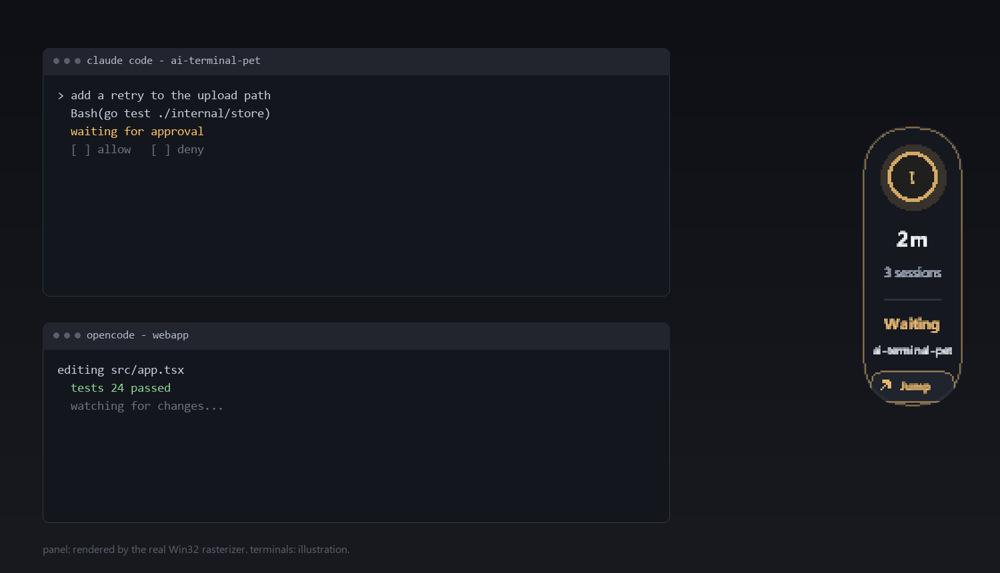

<div align="center">

<h1>ai-terminal-pet</h1>

<p>
  <strong>An always-on-top floating status strip that keeps every running AI coding agent visible — Windows, Linux (X11), and macOS (AppKit).</strong><br />
  DeepSeek Harness · Claude Code · OpenCode · Antigravity
</p>

<p>
  <a href="https://github.com/jjjjjjjjnnjnn/ai-terminal-pet/actions/workflows/ci.yml"></a>
  
  
  
  
</p>

<p>
  <a href="#english">English</a> · <a href="#中文说明">中文</a> · <a href="docs/PLATFORMS.md">Platforms</a> · <a href="docs/PROTOCOL.md">Protocol</a> · <a href="CHANGELOG.md">Changelog</a> · <a href="packages/dsh-ai-terminal-pet/README.md">DSH Plugin</a>
</p>

<br />


<br />



<p><sub>Panel pixels rendered directly by the overlay's own rasterizer (`go test ./internal/ui -run TestRenderPreview`); terminal windows drawn in `docs/assets/make_launch_assets.py`.</sub></p>

</div>

---

<a id="english"></a>

## Why this exists

When you run Claude Code, OpenCode, Antigravity, or DeepSeek Harness across multiple terminal tabs, two frustrating failure modes happen constantly:

1. One agent stops cleanly on a permission prompt or finish line while you are focused in another window — and sits untouched for fifteen minutes.
2. When you finally hear a ping, every tab looks the same and you don't know **which project** is blocked or **for what**.

**ai-terminal-pet** aggregates every local agent session into one native, zero-cgo floating widget (`56 × 156 px` idle pill that expands to `200 px` on hover or click):

- **See every session in one strip**: highest-priority state badge (`ASK` / `PLAN` / `WORK` / `TOOL` / `ERR` / `DONE`), elapsed hold duration, project folder, and prompt reason across terminals.
- **Jump straight back to the terminal or copy the workspace path**: click the row arrow to activate that terminal window/tab (`Windows Terminal`, `SetForegroundWindow` on Win32; EWMH `_NET_ACTIVE_WINDOW` on Linux X11; `NSRunningApplication` on macOS); click the row body to copy its workspace path to clipboard.
- **Keyboard navigation & per-display layout memory**: use `Up` / `Down` / `Home` / `End`, `Enter` to focus, and `Esc` to collapse when expanded; `Ctrl`/`Cmd` + `+`/`-`/`0` (or scroll wheel) scales the panel; window coordinates remember each monitor arrangement independently.
- **Zero-dependency native runtime**: compiled statically with `CGO_ENABLED=0` (`4.49 MiB` main binary on Win64, no runtime DLLs, no Electron, no libgtk, and zero npm dependencies for reporters).

---

## Visual showcase

<table>
  <tr>
    <td width="50%" valign="top">
      <strong>Dark compact &amp; expanded</strong><br />
      
    </td>
    <td width="50%" valign="top">
      <strong>All attention &amp; light states</strong><br />
      
      
      <br />
      
      
    </td>
  </tr>
</table>

---

## Platform matrix

Every platform compiles all 16 Go packages cleanly with `CGO_ENABLED=0`. Details and exact measurement methods live in [docs/PLATFORMS.md](docs/PLATFORMS.md).

| Platform | Window &amp; Text Engine | IPC Endpoint | System Integration | Settings &amp; Audio |
|---|---|---|---|---|
| **Windows (x64)** | Native Win32 layered DIB + ClearType GDI | Named pipe `\\.\pipe\ai-terminal-pet-v1-<8hex>` | Win32 tray icon + context menu, `HKCU\...\Run` autostart, Windows Terminal tab activation | Full 4-tab native Win32 settings window + synthesized WAV via `winmm` |
| **Linux (amd64 / arm64, X11)** | Pure-Go X11 ARGB utility window (`jezek/xgb`) + OpenType glyph rasterizer | Unix socket `$XDG_RUNTIME_DIR/ai-terminal-pet/v1-<8hex>.sock` | `/proc` + `_NET_CLIENT_LIST` + MIT-SCREEN-SAVER + XRandR + X11 `CLIPBOARD` + XDG `.desktop` autostart | Edit `config.json` directly; synthesized WAV through a probed system player (`pw-play` / `paplay` / `aplay`), alerts through `notify-send` — no cgo, and silent when neither is installed |
| **macOS (arm64 / amd64)** | Pure-Go AppKit floating `NSWindow` (`ebitengine/purego`) + OpenType glyph rasterizer | Unix socket `$TMPDIR/ai-terminal-pet-v1-<8hex>.sock` | `NSStatusBar` menu bar item, `sysctl` + `CGWindowListCopyWindowInfo` + `NSRunningApplication`, `NSPasteboard`, `LaunchAgent` | Edit `config.json` directly; synthesized WAV via AppKit `NSSound`; alerts via `osascript` (best-effort — live display unverified without Apple hardware) |

> **Honest verification note**: GitHub Actions runs full Go vet, unit tests, static builds, and headless CLI/install/hook smoke suites on all three real runners (`windows-latest`, `ubuntu-latest`, `macos-latest`). Live interactive X11 rendering was tested on WSLg; interactive Apple WindowServer rendering remains opt-in (`PET_COCOA_PROBE=1`) without Apple hardware. See [docs/PLATFORMS.md](docs/PLATFORMS.md).

---

## Install (3 ways)

Choose **either** the zero-config DeepSeek Harness plugin (Windows), a prebuilt standalone release archive (Windows / macOS / Linux), **or** building from source.

### Option A — DeepSeek Harness Plugin (`dsh-ai-terminal-pet`)

> The package is now **1.2.24** (`dsh.bundle.platforms: ["win32", "linux", "darwin"]`). It connects DeepSeek Harness sessions immediately on all three platforms: on Windows it installs the bundled overlay + `protocol.js` offline on first run, on Linux and macOS it fetches the pinned release archive once (SHA-256 verified) and installs the same overlay.
>
> **Important scope note**: Installing the plugin out-of-the-box shows **DeepSeek Harness** sessions. To also aggregate OpenCode, Claude Code, or Antigravity into the same strip, wire those reporters once using `--connect` below.

<details>
<summary>Install via DSH CLI / npm / tarball / pinned git</summary>

Published on [npmjs.com/package/dsh-ai-terminal-pet](https://www.npmjs.com/package/dsh-ai-terminal-pet) (1.2.24):

```sh
# 1. From npm
dsh plugin --profile <profile> add dsh-ai-terminal-pet

# 2. Direct release tarball
dsh plugin --profile <profile> add https://github.com/jjjjjjjjnnjnn/ai-terminal-pet/releases/download/dsh-plugin-v1.2.24/dsh-ai-terminal-pet-1.2.24.tgz

# 3. Pinned git release tag (no npm required)
dsh plugin --profile <profile> add "git+https://github.com/jjjjjjjjnnjnn/ai-terminal-pet.git#dsh-plugin-v1.2.24&path:/packages/dsh-ai-terminal-pet"
```

See [packages/dsh-ai-terminal-pet/README.md](packages/dsh-ai-terminal-pet/README.md) for full details and uninstall instructions.

</details>

### Option B — Standalone Prebuilt Release (Windows · macOS · Linux)

Download the archive for your OS from the [**latest GitHub Release (`pet-v1.0.14`)**](https://github.com/jjjjjjjjnnjnn/ai-terminal-pet/releases/tag/pet-v1.0.14):

- **Windows (x64)**:
  - **Installer (`pet-setup.exe`)** — single executable; verifies SHA-256 checksums of all embedded files before writing anything, then installs into `%LOCALAPPDATA%\AI-Terminal-Pet\`. *(Not Authenticode-signed yet — see [Unsigned binary notice](#unsigned-binary-notice) below.)*
  - **Portable ZIP (`ai-terminal-pet-1.0.14-win-x64.zip`)** — unzip and double-click `install.cmd` (or run `.\install.cmd` in PowerShell; use `-VerifyOnly` to verify SHA-256, `-AddToPath` to register `AI-Terminal-Pet.exe`, `-Uninstall` to remove).
- **macOS (Apple Silicon `arm64` & Intel `amd64`)**:
  ```sh
  tar -xzf ai-terminal-pet-1.0.14-darwin-arm64.tar.gz   # or darwin-amd64
  cd ai-terminal-pet-1.0.14-darwin-arm64
  xattr -dr com.apple.quarantine .                      # unsigned binary Gatekeeper opt-in
  sh ./install.sh
  ```
  Installs into `~/Library/Application Support/AI-Terminal-Pet` and symlinks `~/.local/bin/ai-terminal-pet`. Supports `sh ./install.sh --verify-only` and `--uninstall`.
- **Linux (`amd64` & `arm64`, X11)**:
  ```sh
  tar -xzf ai-terminal-pet-1.0.14-linux-amd64.tar.gz    # or linux-arm64
  cd ai-terminal-pet-1.0.14-linux-amd64
  sh ./install.sh
  ```
  Installs into `$XDG_DATA_HOME/ai-terminal-pet` (default `~/.local/share/ai-terminal-pet`) and symlinks `~/.local/bin/ai-terminal-pet`. Supports `sh ./install.sh --verify-only` and `--uninstall`.

#### Unsigned binary notice

Windows (`pet-setup.exe`) is not Authenticode-signed and macOS builds are not notarized yet. Every release file can be checked bit-for-bit against `SHA256SUMS.txt` (`install.cmd -VerifyOnly` / `install.sh --verify-only`), and CI workflows + scanners are open in `.github/workflows/ci.yml`.
<details>
<summary>What Windows SmartScreen shows &amp; how to verify locally</summary>

<p>Click <em>More info → Run anyway</em> after checking SHA-256, or build directly from source in Option C.</p>
</details>

### Option C — Build from Source (Go 1.23+, zero cgo)

<details>
<summary>Windows PowerShell &amp; macOS / Linux shell commands</summary>

```powershell
# Windows (PowerShell)
git clone https://github.com/jjjjjjjjnnjnn/ai-terminal-pet.git
cd ai-terminal-pet
go build -trimpath -buildvcs=false -ldflags "-s -w" -o .\bin\AI-Terminal-Pet.exe ./cmd/ai-terminal-pet
go build -trimpath -buildvcs=false -ldflags "-s -w" -o .\bin\pet-statusline.exe ./cmd/pet-statusline
go build -trimpath -buildvcs=false -ldflags "-s -w" -o .\bin\pet-hook.exe ./cmd/pet-hook
.\scripts\install.cmd -AddToPath
```

```sh
# macOS / Linux
git clone https://github.com/jjjjjjjjnnjnn/ai-terminal-pet.git
cd ai-terminal-pet
CGO_ENABLED=0 go build -trimpath -buildvcs=false -ldflags "-s -w" -o ./bin/AI-Terminal-Pet ./cmd/ai-terminal-pet
CGO_ENABLED=0 go build -trimpath -buildvcs=false -ldflags "-s -w" -o ./bin/pet-statusline ./cmd/pet-statusline
CGO_ENABLED=0 go build -trimpath -buildvcs=false -ldflags "-s -w" -o ./bin/pet-hook ./cmd/pet-hook
sh ./scripts/install.sh
```

</details>

---

## Connect your AI coding terminals (`--connect`)

Once installed, run:

```sh
ai-terminal-pet --connect
```

It reads your local host configs **read-only** (never modifies files on your behalf) and prints ready-to-paste snippets with exact resolved binary/script paths for your OS:

| Host CLI | Mechanism | What runs on each event |
|---|---|---|
| **DeepSeek Harness** | Native Cordis plugin (`dsh-ai-terminal-pet` on Windows, or copy `integrations/deepseek-harness/ai-terminal-pet-bridge`) | Subscribes to `session/event` &amp; `approval/request` inside DSH |
| **Claude Code** | Hooks in `~/.claude/settings.json` (`--connect=claude`) | Invokes native `pet-hook` (`--mode=claude`) — fallback: `node .../reporters/claude-hook.js` |
| **OpenCode** | Plugin entry in `~/.config/opencode/opencode.json` (`--connect=opencode`) | Re-exports `reporters/opencode.js` (pure JS, handles `session.*`, `permission.asked`, `session.archived`) |
| **Antigravity CLI** | Statusline + hooks in `~/.gemini/antigravity/settings.json` (`--connect=antigravity`) | Invokes `pet-statusline` (with L1 short-circuit) + `pet-hook --mode=antigravity` |
| **Any custom CLI / script** | Shell wrapper (`reporters/generic.js`) or JSON-lines IPC | Send a single JSON line per state transition — see [docs/PROTOCOL.md](docs/PROTOCOL.md) |

Then run diagnostics (`13 checks`, zero leaks of host tokens/secrets):

```sh
ai-terminal-pet --doctor
```

<details>
<summary>Sample <code>--doctor</code> output</summary>

</details>

---

## CLI reference

| Flag | Purpose |
|---|---|
| *(none)* | Start the overlay if not running, or toggle an existing instance |
| `--show` / `--toggle` | Show or toggle the floating strip |
| `--reset` | Reset panel coordinates, zoom scale, and expand state to default edge dock |
| `--settings` | Open native 4-tab settings UI (Windows); prints `config.json` path &amp; guidance on macOS/Linux |
| `--autostart[=on\|off]` | Query or toggle launch at login (`HKCU\...\Run` / macOS `LaunchAgent` / Linux XDG `.desktop`) |
| `--connect[=HOST]` | Print copy-pasteable host setup snippets (`opencode`, `claude`, `antigravity`), read-only |
| `--doctor` | Run all 11 diagnostics (`environment`, `install files`, `version`, `runtime`, `config`, `pipe`, `instance`, `node`, `reporters`, `autostart`, `alerts`); exits `1` on any `[fail]` |
| `--json [--pretty]` | Output live merged session state + alert receipts as JSON |
| `--quit` | Request graceful shutdown (flushes `config.json` and `state.json`) |
| `--version` / `--help` | Print version / usage |

---

## Auto-approve safety design (opt-in only)

Auto-approve is **off by default**. Even when enabled in `config.json` (or Windows Settings):

1. Every pending permission command is checked against a strict destructive-action blocklist (`rm -rf`, `rd /s`, `format`, `mkfs`, `dd`, `git push --force`, `git reset --hard`, disk/system mutations, etc.) — blocked patterns **always** fall back to manual approval.
2. Safe commands enter a configurable **countdown veto bar** (`5s` default). Clicking the bar or pressing deny immediately writes a `.deny` veto file to stop approval; silence lets the timeout elapse.

---

## Architecture & files on disk

```
Host CLI (DeepSeek Harness / Claude Code / OpenCode / Antigravity / generic)
       │  fire-and-forget hooks (pet-hook / pet-statusline / reporters/*.js)
       ▼
  [Windows Named Pipe  \\.\pipe\ai-terminal-pet-v1-<8hex>]
  [macOS/Linux Socket  $TMPDIR|$XDG_RUNTIME_DIR/...-v1-<8hex>.sock]
       │  + disk snapshot fallback (<data dir>/runtime/*.json)
       ▼
AI-Terminal-Pet (Go 1.23+, CGO_ENABLED=0)
  ├─ internal/pipeserver  ── 32 concurrent conns, 5 s deadline, exact OK / ERR
  ├─ internal/store       ── max 256 sessions, OS-verified existence + 2 min grace + tombstones
  ├─ internal/ui          ── shared buffer & attention policy + Win32 / X11 / AppKit backends
  └─ internal/app         ── single-instance mutex/flock, signals, --doctor, --connect
```

| File / Directory | Purpose |
|---|---|
| **Data root** (`internal/home`) | Windows: `%LOCALAPPDATA%\AI-Terminal-Pet` · macOS: `~/Library/Application Support/AI-Terminal-Pet` · Linux: `$XDG_DATA_HOME/ai-terminal-pet` (or `~/.local/share/ai-terminal-pet`) |
| `config.json` | User settings (notifications, sound cues, always-on-top, edge auto-hide, opacity, language, auto-approve allow/delay) |
| `state.json` | Last expand/zoom state + per-display layout memory (`layouts` keyed by monitor bounds signature) |
| `runtime/*.json` | Reporter session snapshots merged at startup and pruned cleanly when host PIDs disappear |
| `approvals/` | Transient auto-approve pending handshakes (`pending-*.json` / `.deny`) |
| `alerts.json` | Attention classifier receipt log (`approval` / `question` / `plan` / `done`) |
| `error.log` | Fatal/diagnostic error log (`0600`, auto-rotated above 1 MiB) |

---

## Develop & verify from source

All CI gates across Windows (`windows-latest`), Linux (`ubuntu-latest`), macOS (`macos-latest`), and static/vulnerability scanning (`govulncheck` + `gosec`) mirror these local checks:

```sh
gofmt -l .
go vet ./...
go test -count=1 ./...
bash scripts/cross-build.sh                     # verifies all 16 Go packages compile for win/linux/darwin (CGO_ENABLED=0)
for f in reporters/*.js; do node --check "$f"; done
node --test reporters/opencode-events.test.mjs
node integrations/deepseek-harness/verify.mjs
node packages/dsh-ai-terminal-pet/verify.mjs
node tests/fresh-machine.mjs --no-overlay
node tools/check_versions.mjs
node --test tools/check_versions.test.mjs
python tools/check_docs_links.py
```

Key maintainer references:
- [docs/PLATFORMS.md](docs/PLATFORMS.md) — measured per-OS capability table
- [docs/PROTOCOL.md](docs/PROTOCOL.md) — `ai-terminal-pet.v1` JSON wire contract
- [docs/ROADMAP.md](docs/ROADMAP.md) — current baseline and remaining platform/feature plans
- [docs/HANDOVER.md](docs/HANDOVER.md) — full engineering & release runbooks
- [docs/UPSTREAM.md](docs/UPSTREAM.md) — upstream marketplace index & two-commit release order

---

## License & third-party libraries

- Project license: [MIT](LICENSE)
- Third-party Go modules (all statically compiled with `CGO_ENABLED=0`, no external runtime DLLs/libs):
  - [`github.com/Microsoft/go-winio`](https://github.com/Microsoft/go-winio) (MIT) — Windows named pipe ACLs & overlapped I/O
  - [`github.com/lxn/win`](https://github.com/lxn/win) (BSD-3-Clause) — Win32 API bindings
  - [`github.com/ebitengine/purego`](https://github.com/ebitengine/purego) (Apache-2.0) — zero-cgo macOS Objective-C / CoreGraphics / AppKit calls
  - [`github.com/jezek/xgb`](https://github.com/jezek/xgb) (BSD-3-Clause) — pure-Go X11 wire client on Linux
  - [`golang.org/x/image`](https://pkg.go.dev/golang.org/x/image) &amp; [`golang.org/x/sys`](https://pkg.go.dev/golang.org/x/sys) (BSD-3-Clause) — OpenType glyph rasterization &amp; OS syscalls

---

<a id="中文说明"></a>

## 中文说明

<p>
  <strong>一个轻量的置顶桌面状态浮窗，把所有运行中的 AI 编程终端汇总到一块条带上 — 现已全面支持 Windows、Linux (X11) 与 macOS (AppKit)。</strong><br />
  DeepSeek Harness · Claude Code · OpenCode · Antigravity
</p>

### 解决什么问题

同时开多个 AI 编程终端 tab 时，最常见也最浪费时间的两种卡点：

1. 某个终端在等审批或刚跑完任务，你正在另一个窗口写代码，回头才发现它干等了十几分钟。
2. 听到提示音后，多个窗口长相一致，一眼分不清**哪个项目**在等、**在等什么**。

**ai-terminal-pet** 把本机各终端会话的状态聚合到一个轻量浮窗（收起时仅 `56 × 156 px` 窄条，悬停或点击展开为 `200 px`）：

- **全局一览**：按最高优先级显示状态徽标（`ASK` / `PLAN` / `WORK` / `TOOL` / `ERR` / `DONE`）、停留时长、项目名与阻塞原因。
- **一键回跳终端 / 复制路径**：点击行尾箭头直接激活对应终端窗口或标签页（Win32 支持 `Windows Terminal` 页签跳转，Linux X11 通过 `_NET_ACTIVE_WINDOW`，macOS 通过 `NSRunningApplication`）；点击行正文一键复制工作区路径。
- **键盘导航与多显示器记忆**：展开面板支持 `Up` / `Down` / `Home` / `End` 选行、`Enter` 跳转、`Esc` 收起；`Ctrl`/`Cmd` + `+`/`-`/`0` 或鼠标滚轮缩放；坐标按显示器工作区指纹（`State.Layouts`）独立记忆，外接屏来回切换互不覆盖。
- **纯原生零运行期依赖**：全项目使用 `CGO_ENABLED=0` 静态编译 Go 二进制，无 Electron、无 WebView、无 libgtk/cgo，reporter 仅用 Node 标准库（零 npm 依赖）。

### 全平台支持矩阵

三个操作系统全部通过 `CGO_ENABLED=0` 全量静态构建与多平台 CI 验证，详细实测方法与边界见 [docs/PLATFORMS.md](docs/PLATFORMS.md)：

| 平台 | 窗口与字体光栅 | 本地 IPC 端点 | 系统集成 | 设置与提示音 |
|---|---|---|---|---|
| **Windows (x64)** | Win32 分层 ARGB DIB 窗口 + GDI ClearType | 命名管道 `\\.\pipe\ai-terminal-pet-v1-<8hex>` | 托盘图标 + 右键菜单、`HKCU\...\Run` 自启、`Windows Terminal` 页签跳转 | 完整四页签原生 Win32 设置窗口 + `winmm` 合成 WAV 提示音 |
| **Linux (amd64 / arm64, X11)** | 纯 Go `jezek/xgb` X11 ARGB 工具窗 + OpenType 复合字体光栅器 | Unix domain socket `$XDG_RUNTIME_DIR/ai-terminal-pet/v1-<8hex>.sock` | `/proc` + `_NET_CLIENT_LIST` + MIT-SCREEN-SAVER + XRandR + X11 `CLIPBOARD` + XDG `.desktop` 自启 | 直接编辑 `config.json`；合成 WAV 交给探测到的系统播放器（`pw-play` / `paplay` / `aplay`），提醒走 `notify-send` —— 零 cgo，两者都不存在时保持静音 |
| **macOS (arm64 / amd64)** | 纯 Go `purego` AppKit 无边框浮窗 + OpenType 复合字体光栅器 | Unix domain socket `$TMPDIR/ai-terminal-pet-v1-<8hex>.sock` | `NSStatusBar` 菜单栏图标、`sysctl` + `CGWindowListCopyWindowInfo` + `NSRunningApplication`、`NSPasteboard`、`LaunchAgent` | 直接编辑 `config.json` + AppKit `NSSound` 异步 WAV 提示音；提醒走 `osascript`（尽力而为，无苹果硬件、未实测弹窗） |

> **实测边界说明**：GitHub Actions 在三个真实系统 runner（`windows-latest`、`ubuntu-latest`、`macos-latest`）上全量运行 `go vet`、单元测试、三端编译和无头安装/hook/CLI 冒烟验证。Linux X11 浮窗已在 WSLg 实际渲染联调；macOS 图形交互探针（`PET_COCOA_PROBE=1`）受限于无实体苹果硬件尚未在实体桌面实机目视调窗，Objective-C 运行时绑定与几何/控制单测均已在真实 `macos-latest` runner 通过。详见 [docs/PLATFORMS.md](docs/PLATFORMS.md)。

---

### 安装方式（三选一）

#### 方式 A — DeepSeek Harness 插件安装（`dsh-ai-terminal-pet`，Windows）

> 当前版本是 **1.2.24**（包声明 `dsh.bundle.platforms: ["win32", "linux", "darwin"]`）。三个平台的 DeepSeek Harness 0.2.x 都是安装即用：Windows 上首次加载会把内置的浮窗本体与 `protocol.js` 离线落盘，Linux / macOS 上会先下载一次钉住的发布归档（校验 SHA-256）再装同一份浮窗。
>
> **边界说明**：装完包即可在面板看到 **DeepSeek Harness** 的会话；如果需要把 OpenCode、Claude Code 或 Antigravity 也汇入同一块浮窗，请再运行一次下面的 `--connect`。

<details>
<summary>通过 DSH CLI 安装（npm / tarball / git tag）</summary>

已在 npm 发布（[npmjs.com/package/dsh-ai-terminal-pet](https://www.npmjs.com/package/dsh-ai-terminal-pet)，1.2.24）：

```sh
# 1. 通过 npm
dsh plugin --profile <profile> add dsh-ai-terminal-pet

# 2. 通过 Release tarball 直链
dsh plugin --profile <profile> add https://github.com/jjjjjjjjnnjnn/ai-terminal-pet/releases/download/dsh-plugin-v1.2.24/dsh-ai-terminal-pet-1.2.24.tgz

# 3. 钉死 Release tag 的 git 源（无 npm 网络兜底）
dsh plugin --profile <profile> add "git+https://github.com/jjjjjjjjnnjnn/ai-terminal-pet.git#dsh-plugin-v1.2.24&path:/packages/dsh-ai-terminal-pet"
```

更多说明与卸载方式见 [packages/dsh-ai-terminal-pet/README.zh.md](packages/dsh-ai-terminal-pet/README.zh.md)。

</details>

#### 方式 B — 独立安装包 / 压缩包（Windows · macOS · Linux）

前往 [**最新 GitHub Release（`pet-v1.0.14`）**](https://github.com/jjjjjjjjnnjnn/ai-terminal-pet/releases/tag/pet-v1.0.14) 下载对应系统产物：

- **Windows (x64)**：
  - **单文件安装器（`pet-setup.exe`）** — 双击运行，先对内置所有载荷做 SHA-256 逐文件校验再写入 `%LOCALAPPDATA%\AI-Terminal-Pet\`。*（未购置代码签名证书，SmartScreen 弹窗按「更多信息 → 仍要运行」放行即可。）*
  - **绿色压缩包（`ai-terminal-pet-1.0.14-win-x64.zip`）** — 解压后双击 `install.cmd`（支持 `-VerifyOnly` 核对 SHA-256、`-AddToPath` 加 PATH、`-Uninstall` 卸载）。
- **macOS（Apple Silicon `arm64` / Intel `amd64`）**：
  ```sh
  tar -xzf ai-terminal-pet-1.0.14-darwin-arm64.tar.gz   # 或 darwin-amd64
  cd ai-terminal-pet-1.0.14-darwin-arm64
  xattr -dr com.apple.quarantine .                      # 解除未公证下载的隔离属性
  sh ./install.sh
  ```
  默认安装到 `~/Library/Application Support/AI-Terminal-Pet` 并在 `~/.local/bin/ai-terminal-pet` 建软链；支持 `--verify-only` 与 `--uninstall`。
- **Linux（`amd64` / `arm64`，X11）**：
  ```sh
  tar -xzf ai-terminal-pet-1.0.14-linux-amd64.tar.gz    # 或 linux-arm64
  cd ai-terminal-pet-1.0.14-linux-amd64
  sh ./install.sh
  ```
  默认安装到 `$XDG_DATA_HOME/ai-terminal-pet`（通常 `~/.local/share/ai-terminal-pet`）并在 `~/.local/bin/ai-terminal-pet` 建软链；支持 `--verify-only` 与 `--uninstall`。

#### 方式 C — 从源码自行编译（Go 1.23+，零 cgo）

<details>
<summary>Windows PowerShell 与 macOS / Linux 编译安装命令</summary>

```powershell
# Windows (PowerShell)
git clone https://github.com/jjjjjjjjnnjnn/ai-terminal-pet.git
cd ai-terminal-pet
go build -trimpath -buildvcs=false -ldflags "-s -w" -o .\bin\AI-Terminal-Pet.exe ./cmd/ai-terminal-pet
go build -trimpath -buildvcs=false -ldflags "-s -w" -o .\bin\pet-statusline.exe ./cmd/pet-statusline
go build -trimpath -buildvcs=false -ldflags "-s -w" -o .\bin\pet-hook.exe ./cmd/pet-hook
.\scripts\install.cmd -AddToPath
```

```sh
# macOS / Linux
git clone https://github.com/jjjjjjjjnnjnn/ai-terminal-pet.git
cd ai-terminal-pet
CGO_ENABLED=0 go build -trimpath -buildvcs=false -ldflags "-s -w" -o ./bin/AI-Terminal-Pet ./cmd/ai-terminal-pet
CGO_ENABLED=0 go build -trimpath -buildvcs=false -ldflags "-s -w" -o ./bin/pet-statusline ./cmd/pet-statusline
CGO_ENABLED=0 go build -trimpath -buildvcs=false -ldflags "-s -w" -o ./bin/pet-hook ./cmd/pet-hook
sh ./scripts/install.sh
```

</details>

---

### 接入终端（`--connect`）与诊断（`--doctor`）

安装完成后运行只读向导，它会自动检测本机各宿主状态并输出可直接粘贴的配置片段（自动填写当前 OS 真实路径与二进制文件名，**绝不偷偷修改任何配置**）：

```sh
ai-terminal-pet --connect
```

随后运行 13 项系统体检（安装文件、版本、管道/socket、宿主接入状态、自启动与提醒判定、声音与通知表面，任何 fail 返回码为 1）：

```sh
ai-terminal-pet --doctor
```

### 常用命令与路径速查

- **命令行参数**：
  - `--show` / `--toggle` / `--reset` / `--settings` / `--quit`
  - `--autostart[=on|off]`：查询或开关开机自启（Windows 注册表 / macOS `LaunchAgent` / Linux XDG `.desktop`）
  - `--connect[=opencode|claude|antigravity]`：只读打印对应宿主接入配置
  - `--doctor`：运行 13 项健康诊断
  - `--json [--pretty]`：输出实时会话与提醒判定状态 JSON
  - `--version`：打印版本信息（v1.0.14）
  - `--help`：打印帮助说明
- **本地数据目录（`internal/home` 统一解析）**：
  - Windows：`%LOCALAPPDATA%\AI-Terminal-Pet\`
  - macOS：`~/Library/Application Support/AI-Terminal-Pet/`
  - Linux：`$XDG_DATA_HOME/ai-terminal-pet/`（默认 `~/.local/share/ai-terminal-pet/`）
- **文件说明**：`config.json`（开关与外观配置）、`state.json`（位置/缩放/`layouts` 分显示器坐标）、`runtime/*.json`（各终端会话快照）、`approvals/`（可撤回自动审批握手文件）、`alerts.json`（提醒判定记录）、`error.log`（故障日志，`0600` 权限，超过 1 MB 自动轮转）。

### 自动审批安全门控（默认关闭）

auto-approve 功能默认完全关闭；即使启用，也需先通过以下两道保护：

1. **危险命令静态拦截**：包含 `rm -rf`、`rd /s`、`format`、`mkfs`、`git push --force`、`git reset --hard` 等高风险模式时，直接拒绝自动放行并强制人工确认。
2. **倒计时撤回窗**：安全命令进入默认 5 秒倒计时进度条，期间任意点击即写入 `.deny` 撤回；静默超时才放行。

### 本地验证（全平台 CI 同源）

```sh
gofmt -l .
go vet ./...
go test -count=1 ./...
bash scripts/cross-build.sh                     # 三端 CGO_ENABLED=0 跨编译门禁（windows/linux/darwin）
for f in reporters/*.js; do node --check "$f"; done
node --test reporters/opencode-events.test.mjs
node integrations/deepseek-harness/verify.mjs
node packages/dsh-ai-terminal-pet/verify.mjs
node tests/fresh-machine.mjs --no-overlay
node tools/check_versions.mjs
node --test tools/check_versions.test.mjs
python tools/check_docs_links.py
```

### 开源协议与依赖致谢

本项目基于 [MIT](LICENSE) 开源；全部 Go 第三方依赖均静态编入且保持零 cgo：[`github.com/Microsoft/go-winio`](https://github.com/Microsoft/go-winio) (MIT)、[`github.com/lxn/win`](https://github.com/lxn/win) (BSD-3-Clause)、[`github.com/ebitengine/purego`](https://github.com/ebitengine/purego) (Apache-2.0)、[`github.com/jezek/xgb`](https://github.com/jezek/xgb) (BSD-3-Clause)、[`golang.org/x/image`](https://pkg.go.dev/golang.org/x/image) 与 [`golang.org/x/sys`](https://pkg.go.dev/golang.org/x/sys) (BSD-3-Clause)。
