<div align="center">

<h1>ai-terminal-pet</h1>

<p>
  <strong>Your agents are waiting. You are in another tab.</strong><br />
  One 56&nbsp;px always-on-top strip that says which AI coding agent is blocked on you,
  what it is asking for, and how long it has been waiting — then puts you back in that
  terminal in one click.
</p>

<p>DeepSeek Harness · Claude Code · OpenCode · Antigravity</p>

<p>
  <a href="https://github.com/jjjjjjjjnnjnn/ai-terminal-pet/actions/workflows/ci.yml"></a>
  
  
  
  
</p>

<p>
  <a href="#english">English</a> · <a href="#中文说明">中文</a> · <a href="docs/PLATFORMS.md">Platforms</a> · <a href="docs/PROTOCOL.md">Protocol</a> · <a href="CHANGELOG.md">Changelog</a> · <a href="packages/dsh-ai-terminal-pet/README.md">DSH Plugin</a>
</p>

<br />

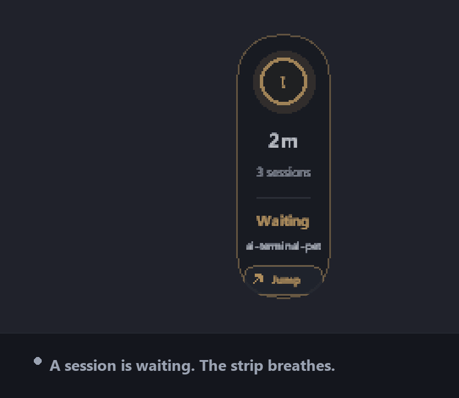

<br />


<p><sub>Panel pixels are rendered by the overlay's own rasterizer (<code>go test ./internal/ui -run TestRenderPreview</code>); the terminal windows around them are drawn in <code>docs/assets/make_launch_assets.py</code>. No mockup of a UI that does not exist.</sub></p>

</div>

---

<a id="english"></a>

## Install in one line

```sh
dsh plugin --profile <profile> add dsh-ai-terminal-pet   # DeepSeek Harness
opencode plugin add opencode-ai-terminal-pet             # OpenCode
```

The panel itself is one file: `pet-setup.exe` on Windows, a `tar.gz` + `install.sh` on Linux and macOS
([Install](#install) has every path, including the pinned-tag and offline forms). On Windows the OpenCode
package carries that panel and drops it in place on first load, so its one line really is one line.
Claude Code and Antigravity are wired once with `ai-terminal-pet --connect`.

**What it is not:** not an Electron app, not a web view, and no runtime to install for the panel itself — a single
5&nbsp;MB Go binary that draws its own pixels and speaks to reporters over a local endpoint. No account, no telemetry, no network.

## The 15-minute problem

You have four agents running in four tabs. One of them hits a permission prompt, waits for an answer, and gets none — because you are reading a diff in another window, or on another monitor, or you only have one monitor and that tab is behind this one.

Nothing crashed. Nothing is broken. You just paid fifteen minutes of an agent's life for nothing, and you will only notice when you switch back and see it still sitting there.

A bell does not fix this. Neither does a spinner in each terminal's own window: the information exists, but it is **inside** the thing you are not looking at.

**ai-terminal-pet** puts that information where you cannot miss it: a 56&nbsp;px strip, always on top, docked to an edge of the screen. It knows every local agent session, what each one is asking for, and how long it has been asking.

## What it does

- **One strip, every agent.** Windows, Linux (X11) and macOS; DeepSeek Harness, Claude Code, OpenCode and Antigravity in one list — sorted so the session that wants *you* is at the top, with its project folder, the reason it is blocked, and how long it has been blocked.
- **One click back.** The arrow at the end of a row activates that terminal — the window *and* the right tab where the platform allows it. Clicking the row body copies its workspace path instead, with a pill that says "Copied" or "Copy failed" rather than staying silent.
- **Quiet until it matters.** It rings only for real events: an agent that asked for something, an agent that failed, an agent that finished while you were away. A conversation that vanished is not a completion, an ordinary command is not an event, and a session you muted stays muted. The full rule table is in [docs/HANDOVER.md](docs/HANDOVER.md) §40–§43.

## What it looks like

<table>
  <tr>
    <td width="46%" valign="top">
      <strong>Compact</strong> — idle, 56&nbsp;px wide<br />
      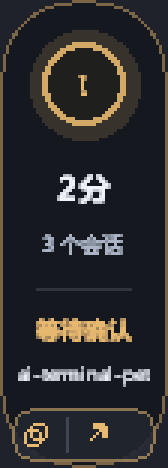
    </td>
    <td width="54%" valign="top">
      <strong>Expanded</strong> — hover or click<br />
      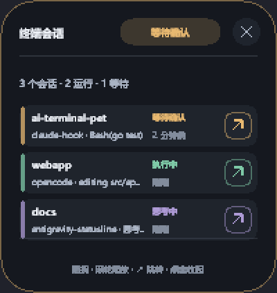
    </td>
  </tr>
  <tr>
    <td valign="top">
      <strong>English UI</strong> (same states, same layout)<br />
      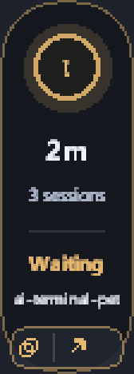
    </td>
    <td valign="top">
      <strong>Longest wait</strong>, then six sessions<br />
      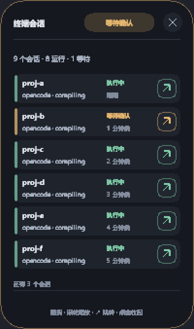
    </td>
  </tr>
  <tr>
    <td valign="top">
      <strong>Unread marks</strong> — what you have not looked at yet<br />
      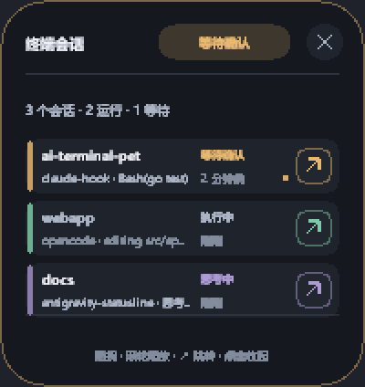
    </td>
    <td valign="top">
      <strong>Copy receipt</strong> — a claim about what happened, not a decoration<br />
      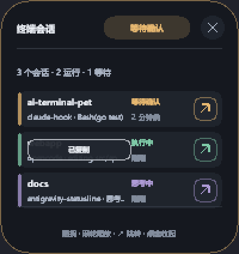
    </td>
  </tr>
  <tr>
    <td valign="top">
      <strong>Auto-approve veto</strong> — opt-in, 5&nbsp;s countdown<br />
      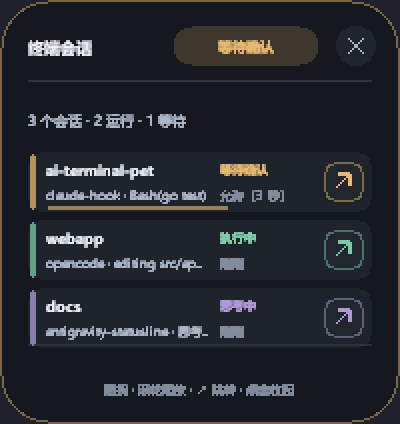
    </td>
    <td valign="top">
      <strong>Hero</strong> — compact and expanded side by side<br />
      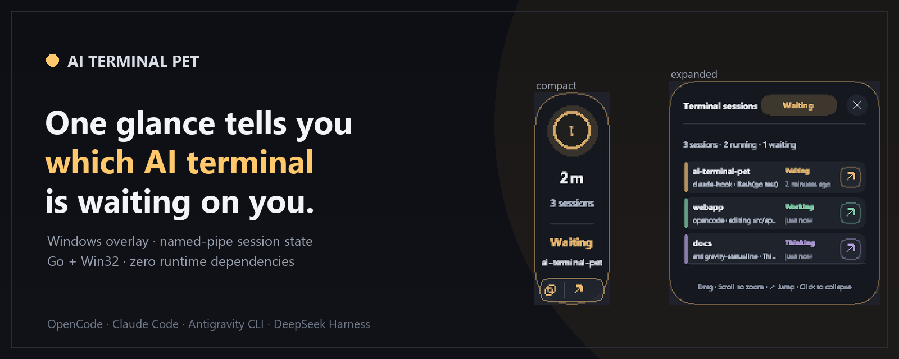
    </td>
  </tr>
</table>

| The row says | Meaning |
|---|---|
| **Waiting** | a permission prompt, a question, or a plan is waiting for your decision |
| **Tool call** / **Working** / **Thinking** | the agent is busy — nothing for you to do yet |
| **Error** | the turn failed; the reason is on the row |
| **Idle** / **Closed** | finished, and waiting to be read |

## Install

The overlay is one statically linked binary per platform (`CGO_ENABLED=0`, no Electron, no WebView, no libgtk, no cgo). Reporters use the Node.js standard library only — zero npm dependencies.

**Windows (x64)** — download `pet-setup.exe` from the [**latest release (`pet-v1.0.22`)**](https://github.com/jjjjjjjjnnjnn/ai-terminal-pet/releases/tag/pet-v1.0.22) and run it. It verifies the SHA-256 of every embedded file before writing anything, then installs into `%LOCALAPPDATA%\AI-Terminal-Pet\` and registers an uninstall entry, so Windows can remove it later even if you delete the download. Prefer a portable archive? Grab `ai-terminal-pet-1.0.22-win-x64.zip`, unzip, and run `.\install.cmd` (`-VerifyOnly`, `-AddToPath`, `-Uninstall` included).

**macOS (Apple Silicon `arm64` / Intel `amd64`)**:

```sh
tar -xzf ai-terminal-pet-1.0.22-darwin-arm64.tar.gz   # or darwin-amd64
cd ai-terminal-pet-1.0.22-darwin-arm64
xattr -dr com.apple.quarantine .                      # unsigned, not notarized yet
sh ./install.sh
```

**Linux (`amd64` / `arm64`, X11)**:

```sh
tar -xzf ai-terminal-pet-1.0.22-linux-amd64.tar.gz    # or linux-arm64
cd ai-terminal-pet-1.0.22-linux-amd64
sh ./install.sh
```

Both POSIX installers land in the platform's data directory, symlink `~/.local/bin/ai-terminal-pet`, and support `--verify-only` / `--uninstall`.

**DeepSeek Harness users** — the plugin is the zero-config path, on all three platforms now:

> The package is now **1.2.35** (`dsh.bundle.platforms: ["win32", "linux", "darwin"]`). It connects DeepSeek Harness sessions immediately: on Windows it installs the bundled overlay + `protocol.js` offline on first run, on Linux and macOS it fetches the pinned release archive once (SHA-256 verified) and installs the same overlay.

```sh
# from npm
dsh plugin --profile <profile> add dsh-ai-terminal-pet

# or pinned to the release tarball
dsh plugin --profile <profile> add https://github.com/jjjjjjjjnnjnn/ai-terminal-pet/releases/download/dsh-plugin-v1.2.35/dsh-ai-terminal-pet-1.2.35.tgz

# or pinned to a git tag, no npm needed
dsh plugin --profile <profile> add "git+https://github.com/jjjjjjjjnnjnn/ai-terminal-pet.git#dsh-plugin-v1.2.35&path:/packages/dsh-ai-terminal-pet"
```

Published on [npmjs.com/package/dsh-ai-terminal-pet](https://www.npmjs.com/package/dsh-ai-terminal-pet) (1.2.35). Details and uninstall: [packages/dsh-ai-terminal-pet/README.md](packages/dsh-ai-terminal-pet/README.md).

Installing the plugin shows **DeepSeek Harness** sessions out of the box. The other three terminals need their reporter wired once — one command each, below. **OpenCode is now that one command**: `opencode plugin add opencode-ai-terminal-pet`.

### Build from source

```powershell
# Windows
git clone https://github.com/jjjjjjjjnnjnn/ai-terminal-pet.git; cd ai-terminal-pet
go build -trimpath -buildvcs=false -ldflags "-s -w" -o .\bin\AI-Terminal-Pet.exe ./cmd/ai-terminal-pet
go build -trimpath -buildvcs=false -ldflags "-s -w" -o .\bin\pet-statusline.exe ./cmd/pet-statusline
go build -trimpath -buildvcs=false -ldflags "-s -w" -o .\bin\pet-hook.exe ./cmd/pet-hook
.\scripts\install.cmd -AddToPath
```

```sh
# macOS / Linux
git clone https://github.com/jjjjjjjjnnjnn/ai-terminal-pet.git; cd ai-terminal-pet
CGO_ENABLED=0 go build -trimpath -buildvcs=false -ldflags "-s -w" -o ./bin/AI-Terminal-Pet ./cmd/ai-terminal-pet
CGO_ENABLED=0 go build -trimpath -buildvcs=false -ldflags "-s -w" -o ./bin/pet-statusline ./cmd/pet-statusline
CGO_ENABLED=0 go build -trimpath -buildvcs=false -ldflags "-s -w" -o ./bin/pet-hook ./cmd/pet-hook
sh ./scripts/install.sh
```

#### Unsigned binary notice

Windows (`pet-setup.exe`) is not Authenticode-signed and macOS builds are not notarized. Every release file can be checked bit-for-bit against `SHA256SUMS.txt` (`install.cmd -VerifyOnly` / `install.sh --verify-only`), and the CI workflows and scanners are in `.github/workflows/ci.yml`.

<details>
<summary>What Windows SmartScreen shows, and how to verify locally first</summary>
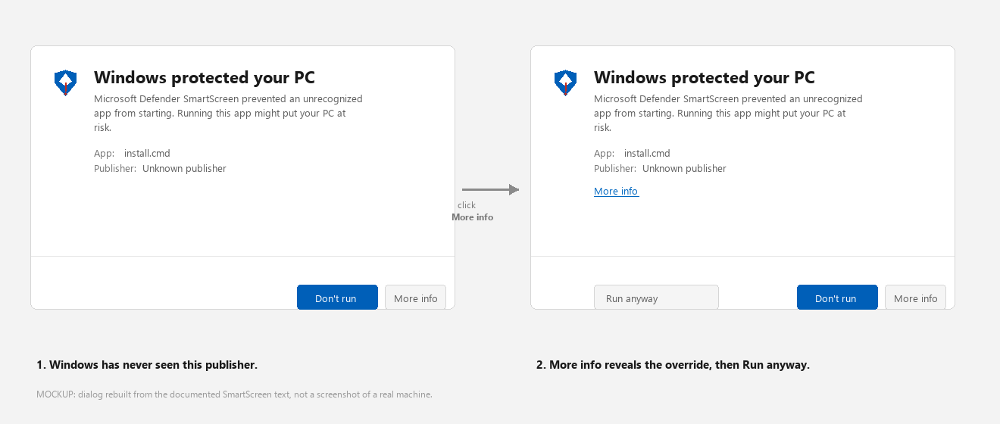
<p>Check the SHA-256, then choose <em>More info → Run anyway</em> — or build from source above.</p>
</details>

## Connect the terminals you already use

```sh
ai-terminal-pet --connect
```

It reads your local host configs **read-only** (it never edits them for you) and prints ready-to-paste snippets with the resolved paths for your OS:

| Host CLI | Mechanism | What runs on each event |
|---|---|---|
| **DeepSeek Harness** | Cordis plugin `dsh-ai-terminal-pet` (or the host-only bridge in `integrations/deepseek-harness/`) | subscribes to `session/event` and `approval/request` inside DSH |
| **Claude Code** | hooks in `~/.claude/settings.json` (`--connect=claude`) | native `pet-hook --mode=claude`, falling back to `reporters/claude-hook.js` |
| **OpenCode** | `opencode plugin add opencode-ai-terminal-pet` (or the entry in `~/.config/opencode/opencode.json`, which `--connect=opencode` prints) | the npm package `opencode-ai-terminal-pet` — the same `reporters/opencode.js` with OpenCode 2.x event names. On Windows it also installs the panel, once, from the copy the package carries |
| **Antigravity CLI** | statusline + hooks in its settings (`--connect=antigravity`) | native `pet-statusline` (with the short-circuit) + `pet-hook --mode=antigravity` |
| **Anything else** | a shell wrapper around `reporters/generic.js`, or JSON lines over the endpoint | one JSON line per state transition — see [docs/PROTOCOL.md](docs/PROTOCOL.md) |

Then check the machine:

```sh
ai-terminal-pet --doctor
```

13 checks — install files, version, endpoint, live instance, Node, host wiring, autostart, the alert decision record, and whether this machine can actually play the tone and show the notification. It exits `1` on any `[fail]` and prints what it measured.

<details>
<summary>Sample <code>--doctor</code> output</summary>
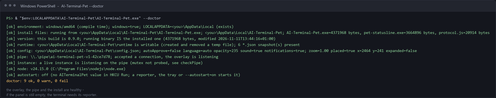
</details>

## Alerts you will not mute

The rule that decides whether to interrupt you is a pure function over the session list, so it can be tested without a window, a clock or a filesystem:

- **One balloon, one tone, one row marked unread** per scan — two finished sessions do not stack two balloons.
- **A conversation that disappeared is not a completion.** A dead reporter, a pruned duplicate or an aged-out snapshot is silent, and the receipt says why.
- **Quiet in place.** If you are looking at the very session that just spoke, the balloon is suppressed; the unread mark is not.
- **Per-session mute, and a "done" policy** (off / background only / always) so a completion you watched yourself does not ring.
- **Every decision is written down** in `alerts.json` (`kind`, `decision`, `tone`, `presence`), which is what `--doctor` and `--json` read when you ask "why was I not told?".

## Local by design

- **No network, no account, no telemetry.** Nothing leaves the machine; the reporters and the overlay talk over a per-user endpoint — a named pipe on Windows, a Unix domain socket elsewhere — whose name is derived from `sha256(lowercased home directory)`. There is no HTTP client in the shipped binaries.
- **Redaction before storage.** The wire layer drops 9 classes of secrets (bearer tokens, `sk-`/`pk-`/`rk-`/`ak-` keys, GitHub tokens, and more) and bounds every field; the panel never sees a raw prompt.
- **Auto-approve is off by default.** Even when enabled, anything matching the destructive-command blocklist always goes to manual review, and safe commands enter a countdown you can veto with one click.

## Platform matrix

Every platform compiles all 16 Go packages cleanly with `CGO_ENABLED=0`. The overlay binary is **4.56 MiB** (4,783,616 bytes) on Win64. Details and measurement methods: [docs/PLATFORMS.md](docs/PLATFORMS.md).

| Platform | Window &amp; text engine | Local endpoint | System integration | Settings &amp; audio |
|---|---|---|---|---|
| **Windows (x64)** | native Win32 layered DIB + ClearType GDI | named pipe `\\.\pipe\ai-terminal-pet-v1-<8hex>` | tray icon + menu, `HKCU\...\Run` autostart, Windows Terminal tab activation | full 4-tab native settings window + synthesized WAV via `winmm` |
| **Linux (amd64 / arm64, X11)** | pure-Go X11 ARGB utility window (`jezek/xgb`) + OpenType rasterizer | Unix socket `$XDG_RUNTIME_DIR/ai-terminal-pet/v1-<8hex>.sock` | `/proc`, `_NET_CLIENT_LIST`, MIT-SCREEN-SAVER, XRandR, X11 `CLIPBOARD`, XDG autostart | `--settings` edits every option in the terminal (`--set key=value` for scripts); the tone goes to a probed system player (`pw-play` / `paplay` / `aplay`), alerts through `notify-send` — silent when neither is installed |
| **macOS (arm64 / amd64)** | pure-Go AppKit `NSWindow` (`ebitengine/purego`) + OpenType rasterizer | Unix socket `$TMPDIR/ai-terminal-pet-v1-<8hex>.sock` | `NSStatusBar` menu bar item, `sysctl` + `CGWindowListCopyWindowInfo` + `NSRunningApplication`, `NSPasteboard`, LaunchAgent | `--settings` edits every option in the terminal (`--set key=value` for scripts); tone via AppKit `NSSound`; alerts via `osascript` (best-effort — see below) |

## How this is verified — and what is not

This is the part most projects leave out, and it is the part that decides whether you can trust a status strip: a strip that lies about state is worse than no strip.

**Measured on every push, on real runners:** `go vet`, **506 `func Test`** across 15 packages, cross-builds for linux/amd64 and darwin/arm64, `go test -race` on Ubuntu, both plugin verifiers, the packaged OpenCode reporter (built from `reporters/` and loaded out of its npm shape on all three platforms), **183 fresh-machine checks** (install → report → `--doctor` → uninstall in a sandbox), version-claim and documentation-link gates, `govulncheck` and `gosec`.

**Not verified, and not planned** — this project has no Apple hardware and no spare Linux desktop, and the maintainer's decision is to skip those runs rather than claim them:

- the macOS panel has never been driven on Apple hardware (CI builds it and runs its AppKit/geometry tests; the AppKit session is not a WindowServer session);
- macOS notifications go through `osascript` and have never been seen on a Mac;
- Linux audio and notifications are verified only down to the process boundary (the probe, the argv, the WAV bytes reaching the player's stdin, the digest-verified download) — not "a speaker made a noise" or "a banner appeared".

Everything above is also written in [docs/PLATFORMS.md](docs/PLATFORMS.md), with the per-platform confidence level next to each capability.

## CLI

| Flag | Purpose |
|---|---|
| *(none)* | start the overlay if it is not running, or toggle a running one |
| `--show` / `--toggle` | show, or toggle, the strip |
| `--reset` | reset coordinates, zoom and expand state to the default edge dock |
| `--settings` | open the native 4-tab settings window (Windows) or the terminal editor (Linux/macOS); piped, it prints every option with its value |
| `--set k=v [k=v …]` | change settings non-interactively and exit; unknown keys and out-of-range values are refused rather than normalised |
| `--autostart[=on\|off]` | query or toggle launch at login (HKCU Run / LaunchAgent / XDG `.desktop`) |
| `--connect[=HOST]` | print copy-pasteable host snippets (`opencode`, `claude`, `antigravity`), read-only |
| `--doctor` | run the 13 diagnostics; exit `1` on any failure |
| `--json [--pretty]` | the merged live state plus the alert receipts, as JSON |
| `--quit` | graceful shutdown (flushes `config.json` and `state.json`) |
| `--version` / `--help` | version / usage |

## Files on disk

| Path | Purpose |
|---|---|
| **Data root** | Windows `%LOCALAPPDATA%\AI-Terminal-Pet` · macOS `~/Library/Application Support/AI-Terminal-Pet` · Linux `$XDG_DATA_HOME/ai-terminal-pet` (or `~/.local/share/ai-terminal-pet`) — one resolver, `internal/home` |
| `config.json` | notifications, sound cue and scheme, always-on-top, edge retract, status-disc animation, opacity, theme, language, per-session mutes, auto-approve |
| `state.json` | zoom, expand state, and one position per monitor layout |
| `runtime/*.json` | reporter session snapshots, merged at startup and pruned when a host disappears |
| `approvals/` | transient auto-approve handshakes (`pending-*.json`, `.deny`) |
| `alerts.json` | the alert decision record |
| `error.log` | diagnostic log (`0600`, rotated above 1 MiB) |
| `install.ps1` | Windows only: the installer's own copy, so the uninstall entry works after you delete the zip |

A Windows install also adds one registry entry, `HKCU\Software\Microsoft\Windows\CurrentVersion\Uninstall\AI-Terminal-Pet` — the Settings › Apps row (`DisplayVersion`, `InstallLocation`, and an uninstall command that asks no prompt). Uninstalling removes it.

## Develop

```sh
gofmt -l .
go vet ./...
go test -count=1 ./...
bash scripts/cross-build.sh                  # all 16 packages, win/linux/darwin, CGO_ENABLED=0
node packages/dsh-ai-terminal-pet/verify.mjs
node tests/fresh-machine.mjs --no-overlay
node tools/check_versions.mjs
python tools/check_docs_links.py
```

Maintainer references: [docs/PLATFORMS.md](docs/PLATFORMS.md) (what works where, measured) · [docs/PROTOCOL.md](docs/PROTOCOL.md) (the wire contract, if you want to write your own reporter) · [docs/HANDOVER.md](docs/HANDOVER.md) (engineering and release runbooks) · [docs/UPSTREAM.md](docs/UPSTREAM.md) (marketplace entries and the two-commit release order) · [docs/ROADMAP.md](docs/ROADMAP.md) (what is next).

## FAQ

**Does it read my prompts or code?** No. A reporter sends state, the project path, a short reason (often just the tool name), tool name and timings. Nine secret patterns are redacted before anything is stored, and the field bounds are in [docs/PROTOCOL.md](docs/PROTOCOL.md) §5.

**Wayland?** The panel is an X11 window; it runs under XWayland on most Wayland desktops, and a pure-Wayland session has no X11 surface for it. WSLg is tested; GNOME, KDE and other desktop environments are not.

**Remote hosts / SSH?** The strip is a desktop window and reporters write to the local endpoint, so both halves must run on the same machine. Agents in a local terminal or a local `tmux` are fine; agents on a remote host report to that host.

**Why not Electron / a browser tab?** Because the point is a 56 px strip that is always there and costs nothing: one static binary, no runtime, no DLLs beyond standard system libraries.

**How do I get rid of it?** On Windows: `Settings › Apps › AI Terminal Pet › Uninstall`, or `install.cmd -Uninstall` if you still have the zip. The first path keeps working after the download is gone — the installer leaves its own copy of `install.ps1` in `%LOCALAPPDATA%\AI-Terminal-Pet` and points the uninstall entry at it. On macOS/Linux: `sh ./install.sh --uninstall`. For the plugin: `dsh plugin --profile <profile> remove dsh-ai-terminal-pet`. Nothing stays resident: with no sessions the process exits on its own.

## License & third-party libraries

[MIT](LICENSE). All Go dependencies are statically compiled with `CGO_ENABLED=0`:

- [`github.com/Microsoft/go-winio`](https://github.com/Microsoft/go-winio) (MIT) — Windows named pipe ACLs & overlapped I/O
- [`github.com/lxn/win`](https://github.com/lxn/win) (BSD-3-Clause) — Win32 API bindings
- [`github.com/ebitengine/purego`](https://github.com/ebitengine/purego) (Apache-2.0) — zero-cgo Objective-C / CoreGraphics / AppKit calls on macOS
- [`github.com/jezek/xgb`](https://github.com/jezek/xgb) (BSD-3-Clause) — pure-Go X11 wire client on Linux
- [`golang.org/x/image`](https://pkg.go.dev/golang.org/x/image) &amp; [`golang.org/x/sys`](https://pkg.go.dev/golang.org/x/sys) (BSD-3-Clause) — OpenType glyph rasterization &amp; syscalls

---

<a id="中文说明"></a>

## 中文说明

<p>
  <strong>你的 agent 在等你，而你在另一个标签页里。</strong><br />
  一条 56&nbsp;px 的置顶窄条，告诉你哪个 AI 编程终端卡住了、在等什么、等了多久 —— 再点一下，直接回到那个终端。
</p>

<p>DeepSeek Harness · Claude Code · OpenCode · Antigravity</p>

### 一行装

```sh
dsh plugin --profile <profile> add dsh-ai-terminal-pet   # DeepSeek Harness
opencode plugin add opencode-ai-terminal-pet             # OpenCode
```

面板本体只有一个文件：Windows 上是 `pet-setup.exe`，Linux / macOS 是 `tar.gz` + `install.sh`
（完整路径——含钉 tag 与离线安装——见英文的 [Install](#install) 一节）。Claude Code 与 Antigravity
用 `ai-terminal-pet --connect` 各接一次。

**它不是什么**：不是 Electron 应用，不是 WebView，**面板本身**没有运行时要装 —— 一个 5&nbsp;MB 的 Go 单文件，
自己画像素，用本地端点跟上上报端说话。没有账号、没有遥测、不出网。

### 那个"十五分钟"的问题

四个 agent，四个标签页。其中一个在等权限确认，没等到 —— 因为你在另一个窗口看 diff，或者在另一块屏，或者只有一块屏而它正好被压在这一页下面。

没崩、没报错，只是白等了十五分钟；而你要切回去才看得到它还在等。

提示音解决不了这件事，每个终端自己窗口里的那个转圈也解决不了：信息确实存在，但它**在你没看的地方**。

**ai-terminal-pet** 把它放到你不可能错过的地方：一条 56&nbsp;px 宽、始终置顶、贴屏幕边的窄条。它认识本机每一个 agent 会话，知道每个会话在等什么、等了多久。

### 它做什么

- **一条窄条，所有 agent。** Windows / Linux (X11) / macOS；DeepSeek Harness、Claude Code、OpenCode、Antigravity 汇成一张列表 —— 排序把**最需要你**的会话放最上面，附带项目目录、卡住的原因、已经等了多久。
- **点一下就能回去。** 行尾箭头激活对应终端（平台允许时连标签页一起切）；点行正文则复制它的工作区路径，并用一张"已复制 / 复制失败"的小条告诉你结果，而不是点了没反应。
- **只在真事件上出声。** 向你提问、出错、你不在时跑完 —— 只有这三种会打扰你。会话消失不算完成，普通命令不算事件，被你静音的会话保持安静。完整规则表在 [docs/HANDOVER.md](docs/HANDOVER.md) §40–§43。

### 它长什么样

<table>
  <tr>
    <td width="46%" valign="top">
      <strong>收起态</strong> —— 空闲时 56&nbsp;px<br />
      
    </td>
    <td width="54%" valign="top">
      <strong>展开态</strong> —— 悬停或点击<br />
      
    </td>
  </tr>
  <tr>
    <td valign="top">
      <strong>六行会话</strong><br />
      
    </td>
    <td valign="top">
      <strong>未读标记</strong> —— 你还没看过的<br />
      
    </td>
  </tr>
  <tr>
    <td valign="top">
      <strong>复制回执</strong><br />
      
    </td>
    <td valign="top">
      <strong>自动审批撤回窗</strong> —— 默认关闭，启用后 5 秒倒计时<br />
      
    </td>
  </tr>
</table>

| 行上写着 | 含义 |
|---|---|
| **等待** | 权限确认、一个问题、或一个方案在等你决定 |
| **工具调用** / **进行中** / **思考中** | agent 正忙 —— 现在还没你的事 |
| **出错** | 这一轮失败了，原因在行上 |
| **空闲** / **已结束** | 跑完了，等你去看 |

### 安装

浮窗本体是每个平台一个静态二进制（`CGO_ENABLED=0`，无 Electron、无 WebView、无 libgtk、无 cgo）；上报端只用 Node.js 标准库，零 npm 依赖。

**Windows (x64)** —— 从[**最新 Release（`pet-v1.0.22`）**](https://github.com/jjjjjjjjnnjnn/ai-terminal-pet/releases/tag/pet-v1.0.22) 下载 `pet-setup.exe` 双击运行：写入前先逐文件核对内嵌载荷的 SHA-256，然后装到 `%LOCALAPPDATA%\AI-Terminal-Pet\`，并登记一条卸载项——之后就算你把下载的 zip 删了，Windows 也能把它卸干净。想要绿色版就用 `ai-terminal-pet-1.0.22-win-x64.zip`，解压后运行 `.\install.cmd`（支持 `-VerifyOnly` / `-AddToPath` / `-Uninstall`）。

**macOS（Apple Silicon `arm64` / Intel `amd64`）**：

```sh
tar -xzf ai-terminal-pet-1.0.22-darwin-arm64.tar.gz   # 或 darwin-amd64
cd ai-terminal-pet-1.0.22-darwin-arm64
xattr -dr com.apple.quarantine .                      # 未签名、未公证
sh ./install.sh
```

**Linux（`amd64` / `arm64`，X11）**：

```sh
tar -xzf ai-terminal-pet-1.0.22-linux-amd64.tar.gz    # 或 linux-arm64
cd ai-terminal-pet-1.0.22-linux-amd64
sh ./install.sh
```

两个 POSIX 安装脚本都装进各平台的数据目录、在 `~/.local/bin/ai-terminal-pet` 建软链，并支持 `--verify-only` / `--uninstall`。

**DeepSeek Harness 用户** —— 插件是零配置路径，现在三个平台都行：

> 当前版本是 **1.2.35**（包声明 `dsh.bundle.platforms: ["win32", "linux", "darwin"]`）。装完即可看到 DeepSeek Harness 的会话：Windows 上首次加载会把内置的浮窗本体与 `protocol.js` 离线落盘；Linux / macOS 上会先下载一次钉住的发布归档（校验 SHA-256）再装同一份浮窗。

```sh
# 通过 npm
dsh plugin --profile <profile> add dsh-ai-terminal-pet

# 或钉住 Release tarball
dsh plugin --profile <profile> add https://github.com/jjjjjjjjnnjnn/ai-terminal-pet/releases/download/dsh-plugin-v1.2.35/dsh-ai-terminal-pet-1.2.35.tgz

# 或钉住 git tag（不需要 npm）
dsh plugin --profile <profile> add "git+https://github.com/jjjjjjjjnnjnn/ai-terminal-pet.git#dsh-plugin-v1.2.35&path:/packages/dsh-ai-terminal-pet"
```

已在 npm 发布（[npmjs.com/package/dsh-ai-terminal-pet](https://www.npmjs.com/package/dsh-ai-terminal-pet)，1.2.35）。更多说明与卸载方式见 [packages/dsh-ai-terminal-pet/README.zh.md](packages/dsh-ai-terminal-pet/README.zh.md)。

装插件默认只显示 **DeepSeek Harness** 的会话；另外三个终端各接一次上报端即可。**OpenCode 现在是一行**：`opencode plugin add opencode-ai-terminal-pet`（上报端就是这个包，`--connect` 会打印你可以自己贴的那段配置）。

### 接入本机终端

```sh
ai-terminal-pet --connect
```

只读地读一遍本机宿主配置（**绝不替你修改**），打印当前 OS 可直接粘贴的片段。支持的宿主、机制与每个事件跑什么，见上方的英文表格（DeepSeek Harness / Claude Code / OpenCode / Antigravity / 任意 CLI）。

随后体检：

```sh
ai-terminal-pet --doctor
```

共 **13 项**：安装文件、版本、端点、实例、Node、宿主接入、自启动、提醒判定记录，以及这台机器**能不能真的出声、能不能真的弹通知**。任一 `[fail]` 返回码为 1，并且每一项都打印它量到的值。

### 本地优先

- **不出网、无账号、无遥测。** 上报端与浮窗只走按用户派生的本地端点（Windows 命名管道 / 其他平台 Unix domain socket），端点名由 `sha256(小写化的用户目录)` 前 4 字节派生；发行版二进制里没有 HTTP 客户端。
- **落盘前先脱敏。** 线协议层丢弃 9 类机密（Bearer、`sk-`/`pk-`/`rk-`/`ak-` 开头的 key、GitHub token 等），并对每个字段设上限；面板永远看不到原始 prompt。
- **自动审批默认关闭。** 即使启用，命中危险命令黑名单的一律转人工；安全命令进入可一键撤回的倒计时窗。

### 全平台矩阵

三个系统全部以 `CGO_ENABLED=0` 通过 16 个 Go 包的构建；Win64 上的浮窗本体是 **4.56 MiB**（4,783,616 B）。逐项实测方法与边界见 [docs/PLATFORMS.md](docs/PLATFORMS.md)，矩阵表与英文版一致。

### 验证到什么程度 —— 以及哪些没有

**每次推送都会在真实 runner 上量到的**：`go vet`、15 个包共 **506 个 `func Test`**、linux/amd64 与 darwin/arm64 交叉构建、Ubuntu 上的 `go test -race`、两个插件校验、**打包后的 OpenCode 上报端**（由 `reporters/` 生成，按 npm 包形态在三个平台上加载并投递）、**183 项 fresh-machine 检查**（沙箱里装 → 上报 → `--doctor` → 卸载）、版本声明与文档链接门禁、`govulncheck` 与 `gosec`。

**没有验证、而且不打算验证的** —— 这个项目没有苹果硬件，也没有多余的 Linux 桌面，维护者的决定是不做这些实测、也不把它们写成"已验证"：

- macOS 面板从未在苹果硬件上真的开过窗（CI 只构建它、跑 AppKit/几何单测）；
- macOS 通知走 `osascript`，从未在 Mac 上被看到；
- Linux 的声音与通知只验证到进程边界（探测、argv、WAV 字节确实进了播放器 stdin、下载的摘要），**没有**验证"音箱响了"或"横幅出现了"。

### 命令行与文件

常用参数：`--show` / `--toggle` / `--reset` / `--settings`（有窗口时开窗口，否则进终端编辑器）/ `--set k=v` / `--autostart[=on|off]` / `--connect[=HOST]` / `--doctor` / `--json [--pretty]` / `--quit` / `--version`（打印版本信息（v1.0.22））/ `--help`。

数据目录：Windows `%LOCALAPPDATA%\AI-Terminal-Pet\`、macOS `~/Library/Application Support/AI-Terminal-Pet/`、Linux `$XDG_DATA_HOME/ai-terminal-pet/`（默认 `~/.local/share/ai-terminal-pet/`）。其中 `config.json`（开关与外观）、`state.json`（位置/缩放/分屏坐标）、`runtime/*.json`（会话快照）、`approvals/`（自动审批握手）、`alerts.json`（提醒判定记录）、`error.log`（故障日志，`0600`，超过 1 MiB 轮转）。

### 常见问题

**它会读我的 prompt 和代码吗？** 不会。上报的是状态、项目路径、一个很短的 reason（常常只是工具名）、工具名与时间戳；9 类机密在落盘前被替换，字段上限见 [docs/PROTOCOL.md](docs/PROTOCOL.md) §5。

**Wayland 呢？** 面板是 X11 窗口，在多数 Wayland 桌面上经 XWayland 运行；纯 Wayland 会话没有 X11 表面。WSLg 实测过，GNOME / KDE 等桌面未实测。

**SSH / 远程主机呢？** 窄条是桌面窗口，上报端写本地端点，所以两半必须在同一台机器上。本机终端或本机 `tmux` 里的 agent 没问题；远程主机上的 agent 只会报到那台主机。

**为什么不用 Electron / 网页？** 因为它的意义就是一条 56 px、一直存在、几乎不占资源的窄条：一个静态二进制，没有运行时，除系统库外没有 DLL。

**怎么彻底去掉？** Windows 走 `设置 › 应用 › AI Terminal Pet › 卸载`，或者还留着 zip 时用 `install.cmd -Uninstall`。第一条在下载文件删掉之后照样有效——安装器把 `install.ps1` 自己的副本留在 `%LOCALAPPDATA%\AI-Terminal-Pet`，卸载项指的就是它。其它平台 `sh ./install.sh --uninstall`，插件用 `dsh plugin --profile <profile> remove dsh-ai-terminal-pet`。它也常驻不了：没有会话时进程会自己退出。

### 开源协议与依赖致谢

本项目基于 [MIT](LICENSE) 开源；全部 Go 第三方依赖均静态编入且保持零 cgo：[`github.com/Microsoft/go-winio`](https://github.com/Microsoft/go-winio) (MIT)、[`github.com/lxn/win`](https://github.com/lxn/win) (BSD-3-Clause)、[`github.com/ebitengine/purego`](https://github.com/ebitengine/purego) (Apache-2.0)、[`github.com/jezek/xgb`](https://github.com/jezek/xgb) (BSD-3-Clause)、[`golang.org/x/image`](https://pkg.go.dev/golang.org/x/image) 与 [`golang.org/x/sys`](https://pkg.go.dev/golang.org/x/sys) (BSD-3-Clause)。
