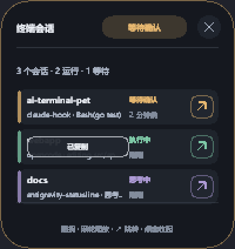

# dsh-ai-terminal-pet

**English** · [中文](./README.zh.md)

A DeepSeek Harness (DSH) Cordis bundle that mirrors Harness session state onto
the [AI Terminal Pet](https://github.com/jjjjjjjjnnjnn/ai-terminal-pet) desktop
overlay: a small always-on-top Win32 pet that shows which sessions are working,
which one is waiting for your approval, which failed, and which finished.

The package ships the overlay binary and the official reporter protocol module
inside the tarball, so a single market install is enough to get a pet on screen
that follows **this Harness's** sessions. It does not attach to any other
terminal by itself: sessions from OpenCode, Claude Code and Antigravity appear
only after that terminal's own reporter is installed into it. The repository
README section [Connect your terminal](https://github.com/jjjjjjjjnnjnn/ai-terminal-pet#connect-your-terminal)
has one hook per terminal; the panel, the pipe and the protocol are shared, so
once a terminal reports it shows up next to the Harness sessions.

No npm dependencies, no install scripts, no network calls at runtime (unless the
maintainer pins a release in lib/release-pins.json, see below).

## What it does

| Harness signal | Overlay state |
| --- | --- |
| `turn/start`, `agent/inbox/claimed`, `agent/status` running | working |
| `tool/call` | tool_use |
| `approval/request` (waterfall listener) | waiting_permission |
| `tool/result` with `error`, `agent/error` | error |
| `turn/end`, `agent/status` idle | idle |
| Harness process exit | closed |

Events this table does not list are not part of the Harness session log: there is
no `command/done` or `working-directory/change` in `SessionEventMap`. The project
path, the parent session and the session start time do not come from events at
all - they are read from `session.header` (`cwd`, `parentSession`, `createdAt`),
which is the only place the host states them. That is also why a session shows
the right project even though the desktop Harness itself runs from its install
directory, and why a subagent conversation is nested under the session it was
forked from.

The overlay then plays an alert tone, shows a tray balloon on those transitions
and its one-click jump button targets the Harness window. Plugin reload (HMR)
disposes the listeners but deliberately does not close sessions: only a real
process exit means the conversation is over.

Panel gestures (overlay 1.0.5 and later): clicking a session row - or the left
half of the compact strip - copies that conversation's working directory to the
clipboard and shows a short "Copied" receipt over the row; clicking anywhere
else still collapses the panel. The copy is the path, not the label the row
prints.


*The receipt after a click on a session row: the path is on the clipboard and the
row says so for about a second. A failed copy says "Copy failed" instead of
claiming success.*

## Where it is listed, and what each market indexes

Three independent paths exist today, and each one reads a different field:

| Market | What it indexes | What this package offers it |
| --- | --- | --- |
| npm registry | package name, version, `dist.integrity` | published as `dsh-ai-terminal-pet`; a market that installs by name gets a verified tarball |
| dshmarket (the market tab most Harness Desktop users run) | `https://awesome-dsh-plugin.com/plugins.json`, which is generated from the [awesome-dsh-plugin](https://github.com/awesome-dsh-plugin/awesome-dsh-plugin) repository | entry merged via PR [#13937](https://github.com/awesome-dsh-plugin/awesome-dsh-plugin/pull/13937); the `install` command it renders comes from that entry's pinned `tarball`, so bumping it is always a pull request *there*, never an edit here |
| GitHub-harvesting markets | repositories carrying the `dsh-plugin` topic plus a root `package.json` declaring `name` and `dsh.bundle` | this repository has the topic and the root shim manifest, which is what makes `dsh plugin add github:owner/repo` resolve instead of mounting a 0.0.0 dependency |

"Listed" and "visible" are different states, and only the second one helps a
user: the awesome entry existed before its `plugins.json` entry did, because the
site builds the catalog on a schedule. Check the market's own public index, not
the merged pull request. The package README cannot promise what another
repository's build will render; it can only promise that the fields those builds
read are present and correct.

The package describes itself to storefronts through `dsh.catalog`: a category, a
one-line summary in both languages, and the capabilities it uses. Capabilities
are self-declared and never checked — DSH does not sandbox plugins — so read them
as a description, not a permission grant.
The bundle loads on Windows, Linux and macOS and declares
`dsh.bundle.platforms: ["win32", "linux", "darwin"]`. The window layer differs
per platform (Win32 layered DIB, pure-Go X11, pure-Go AppKit); the reporting path
is the same everywhere.

It also declares `dsh.marketplace` (`profiles: ["desktop", "headless", "web"]`,
`requiresBuildApproval: false`, `manualSteps: false`). DSH itself never reads
that field - the bundle mounts through `dsh.bundle` either way - but storefronts
that sort entries by profile do: without it a registry falls back to a
headless-or-web guess and a desktop client hides the entry.

Manually, from a terminal, into a profile you own — by package name, by release
tarball, or by pinning the release tag. All three are verified end to end:

```sh
# by package name: published on npm, no clone, no Go toolchain
dsh plugin --profile <profile> add dsh-ai-terminal-pet

# release tarball: same bytes as the npm release, straight from the GitHub Release
dsh plugin --profile <profile> add https://github.com/jjjjjjjjnnjnn/ai-terminal-pet/releases/download/dsh-plugin-v1.2.25/dsh-ai-terminal-pet-1.2.25.tgz

# git source, pinned to the release tag
dsh plugin --profile <profile> add "git+https://github.com/jjjjjjjjnnjnn/ai-terminal-pet.git#dsh-plugin-v1.2.25&path:/packages/dsh-ai-terminal-pet"
```

Those three differ only in transport. The npm path is the shortest and the one a
market uses when it installs by name; the tarball path works when a market pins a
release asset instead of a registry entry; the git path is the fallback for a
machine that cannot reach npm at all. Every one of them lands the same
prebuilt overlay in `vendor/`.

Do not hand pnpm a bare repository URL. pnpm resolves a git dependency by
running the package's lifecycle scripts, and it blocks those for unpinned
git sources until you copy the `allowBuilds` key it prints into your profile's
`pnpm-workspace.yaml`; the failure message never mentions AI Terminal Pet. The
package therefore ships no lifecycle hook, and its vendored overlay is a
committed file rather than a build product. `vendor/manifest.json` records the
SHA-256 of that file, the SHA-256 of the Go sources it was built from, and the
Go version that produced it, so a stale or hand-edited vendor directory fails a
check instead of shipping quietly.

The GitHub and npm paths above need nothing from this repository at install time.
`dsh plugin add dsh-ai-terminal-pet` resolves through the npm registry; the
tarball and git forms resolve through GitHub. A marketplace that indexes npm
sees the package under its own name and can verify the published integrity
digest; a marketplace that indexes repositories sees the `dsh-plugin` topic and
the root shim manifest.

`add` is the whole install: the profile records the dependency, and the bundle
declares itself through `dsh.bundle.patch`, so no separate `enable` step exists.
The profile you add it to has to be the one Harness boots.

Two profiles are special. The reserved `desktop` profile is rejected by the
standalone `dsh` CLI (`profile "desktop" is managed exclusively by the Electron
application`); the Desktop app's own bundled CLI does accept it, and the in-app
plugin manager is the supported path there. Any other profile name is yours.

If the app reports restart-required after enabling the bundle, restart Harness.

## What it writes on disk

First use in a Harness process installs two files, and only when they are missing:

| File | Origin | Purpose |
| --- | --- | --- |
| `<data directory>/protocol.js` | vendor/protocol.js | endpoint name, state set, redaction, snapshot |
| `<data directory>/AI-Terminal-Pet.exe` (Windows) | vendor/AI-Terminal-Pet.exe | the Win32 overlay, offline |
| `<data directory>/AI-Terminal-Pet` (Linux, macOS) | the pinned release archive | the same overlay, fetched once |

The data directory is `%LOCALAPPDATA%\AI-Terminal-Pet` on Windows,
`~/Library/Application Support/AI-Terminal-Pet` on macOS, and
`$XDG_DATA_HOME/ai-terminal-pet` (or `~/.local/share/ai-terminal-pet`) on Linux -
the same rule `reporters/protocol.js` and the Go side already use, and a test
pins the two JavaScript answers together on every OS.

Nothing is ever overwritten: an existing file, including one placed by the
standalone installer, wins. Set DSH_PET_NO_BOOTSTRAP=1 to skip this step
entirely (for example when the overlay is managed by the installer already).

Reports also write the overlay's normal runtime snapshot under the same
directory, exactly like every other reporter.

### How Linux and macOS get the binary

One tarball serves every platform, and carrying four more ~2 MB binaries would
make every Windows install pay for platforms it cannot run. So the package ships
the Windows overlay in `vendor/` (fully offline) and **no** POSIX binary;
`lib/release-pins.json` pins the four release archives by URL, byte count and
SHA-256, and the first use on Linux or macOS downloads the matching one over
HTTPS with a 30 s timeout, verifies the digest with `node:crypto`, extracts one
member and installs it `0755`. Any failure leaves one warning and no file: the
plugin keeps reporting, the panel simply is not installed, and
`scripts/install.sh` from the release archive remains the manual route.

Windows never reads that file. Its binary ships in `vendor/`, so a Windows
install works with no network at all.

## The overlay itself is still standalone

This bundle is a convenience wrapper: it reports Harness sessions and installs
the overlay for you. The overlay is the same zero-cgo Go application on all three
platforms - Win32 layered window on Windows, pure-Go X11 on Linux, pure-Go AppKit
via purego on macOS - installable on its own with `scripts/install.ps1` (Windows)
or `scripts/install.sh` (macOS, Linux), and every other reporter (Claude Code,
OpenCode, Antigravity, generic) talks to the same per-user endpoint: a named pipe
on Windows, a Unix domain socket elsewhere.
Those reporters are separate installs, not part of this package: a terminal that
has none of them hooked reports nothing, in this install or in any other. A
machine that only wants the overlay does not need this package; a machine that
only wants the plugin gets the overlay installed for it.

## Requirements and limits

- Windows, Linux (X11) or macOS. The panel is verified live on Windows and on
  WSLg X11; the macOS panel is built and unit-tested on `macos-latest` but has
  never been driven on Apple hardware, and macOS notifications go through
  `osascript` as a best-effort surface.
- The POSIX overlay arrives by one pinned HTTPS download on first use, so a
  machine with no network on first run needs `scripts/install.sh` instead.
- DeepSeek Harness 0.2.x. `engines.dsh` is `>=0.2.0-0 <0.3.0-0`, and since DSH
  0.2.1-alpha.3 the host reads that range alone: a bundle whose range the running
  DSH does not satisfy is refused and the profile rolled back, so the range is the
  whole compatibility statement. The `-0` bounds are deliberate - DSH evaluates
  the range with semver's `includePrerelease`, under which `<0.3.0` still admits
  `0.3.0-rc.1` and `>=0.2.0` still refuses `0.2.0-rc.1`. Both ends were measured
  against the host's own compatibility function. It was verified by installing
  this tarball into a real 0.2.0-rc.1 host and a real 0.2.2-rc.3 host and
  composing its layer with `dsh --dump-config`.
- Node 24.9+ in the Harness runtime, which is what DSH 0.2.x itself requires.
- Nothing in this package can fail the host: every entry point is wrapped,
  every report is fire-and-forget, and there is no process.exit.
- Session id is the Harness session.header.id; pid is a synthetic per-session
  id and parentPid is the real Harness process, which is how the overlay ties a
  session to its terminal window.
