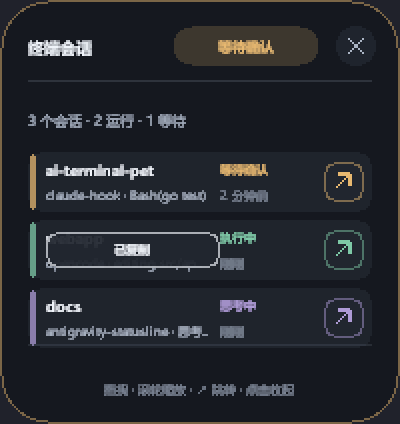

# dsh-ai-terminal-pet

[English](./README.md) · **中文**

一个 DeepSeek Harness（DSH）的 Cordis bundle：把 Harness 的会话状态送到
[AI Terminal Pet](https://github.com/jjjjjjjjnnjnn/ai-terminal-pet) 桌面浮窗上——
一个常驻置顶的小窗，一眼看出哪些会话在跑、哪一个在等你确认、哪个出错、哪个已经完成。

包里带着**预编译好的浮窗**和官方的上报协议模块，所以装上这一个包，屏幕上就有一块跟着
**这个 Harness** 的会话走的面板。它**不会**自己接上别的终端：OpenCode、Claude Code 与 Antigravity
的会话，要先给那个终端各自装好上报端才会出现。每个终端对应一行钩子，写在仓库 README 的
[Connect your terminal](https://github.com/jjjjjjjjnnjnn/ai-terminal-pet#connect-your-terminal)
一节里；面板、管道与协议是共用的，所以某个终端一旦开始上报，它的会话就会出现在 Harness 会话旁边。

没有任何 npm 依赖、没有安装期脚本、运行期不联网（除非维护者在 `lib/release-pins.json` 里显式钉了一个
Release 资产，见下文）。

## 它做了什么

| Harness 的信号 | 浮窗状态 |
| --- | --- |
| `turn/start`、`agent/inbox/claimed`、`agent/status` 处于 running | working（进行中） |
| `tool/call` | tool_use（调用工具） |
| `approval/request`（waterfall 监听） | waiting_permission（等待确认） |
| `tool/result` 带 `error`、`agent/error` | error（出错） |
| `turn/end`、`agent/status` 处于 idle | idle（空闲） |
| Harness 进程退出 | closed（结束） |

这张表没列出的事件不属于 Harness 的会话日志：`SessionEventMap` 里没有 `command/done`，也没有
`working-directory/change`。项目路径、上级会话与开始时间**不是**从事件里来的——它们读的是
`session.header`（`cwd`、`parentSession`、`createdAt`），那是宿主唯一陈述这些信息的地方。
这也解释了两件事：为什么桌面版 Harness 自己从安装目录启动、面板上每条会话的项目仍然正确；
以及为什么子代理的对话会挂在它被 fork 出来的那个会话下面。

浮窗在这些状态跃迁上响一声、弹一个托盘气泡，它那个一键跳转按钮指向 Harness 窗口。
插件热重载（HMR）会释放监听器，但**有意不关闭会话**：只有真正的进程退出才代表对话结束。

面板手势（浮窗 1.0.5 及以后）：点一行会话——或紧凑条的左半——会把该会话的工作目录复制进剪贴板，
并在那一行上显示一个很短的「已复制」回执；点其它地方仍然是收起面板。复制的是**路径**，
不是行上显示的标签。


*点过一行之后的回执：路径已在剪贴板里，那一行会这样显示约一秒。复制失败时写的是「复制失败」，
而不是假装成功。*

## 它被哪些市场收录，各自索引什么

现在有三条互相独立的路径，各自读的字段不同：

| 市场 | 它索引什么 | 这个包给它什么 |
| --- | --- | --- |
| npm registry | 包名、版本、`dist.integrity` | 以 `dsh-ai-terminal-pet` 发布；按包名安装的市场拿到的是一份可校验的 tarball |
| dshmarket（多数 Harness 桌面用户看到的 Market 页） | `https://awesome-dsh-plugin.com/plugins.json`，由 [awesome-dsh-plugin](https://github.com/awesome-dsh-plugin/awesome-dsh-plugin) 仓库生成 | 条目已通过 PR [#13937](https://github.com/awesome-dsh-plugin/awesome-dsh-plugin/pull/13937) 合并；页面渲染的 `install` 命令来自该条目里钉住的 `tarball`，所以升级永远是**那边**一个 PR，不是改这里 |
| 抓取 GitHub 的市场 | 带 `dsh-plugin` topic、且根 `package.json` 声明了 `name` 与 `dsh.bundle` 的仓库 | 本仓库有 topic，也有根清单 shim——后者才是 `dsh plugin add github:owner/repo` 能解析、而不是挂上一个 0.0.0 依赖的原因 |

「已收录」和「已可见」是两种状态，只有后者对用户有用：awesome 的条目比它的 `plugins.json` 条目出现得更早，
因为站点是**按计划重建**的。判断可见性要读市场自己的公开索引，不要读已合并的 PR。这个包的 README
没法承诺另一个仓库的构建会渲染什么，它只能承诺那些构建读的字段都在、而且是对的。

包通过 `dsh.catalog` 向商店自述：一个 category、两种语言各一行摘要，以及它用到的 capabilities。
capabilities 是**自我声明**、从不校验——DSH 并不沙箱化插件——所以请把它当描述读，而不是权限清单。
这个 bundle 只在 Windows 上可用，声明了 `dsh.bundle.platforms: ["win32"]`，因此其它平台显示为
不支持，而不是装上去再坏。

它还声明了 `dsh.marketplace`（`profiles: ["desktop", "headless", "web"]`、
`requiresBuildApproval: false`、`manualSteps: false`）。DSH 自己从不读这个字段——bundle 走
`dsh.bundle` 照样能挂上——但**按 profile 过滤条目**的商店会读：没有它，注册表会退回到
「大概 headless 或 web」的猜测，桌面客户端于是把这个条目藏起来。

手工从终端装进你自己的 profile——按包名、按 Release tarball，或钉住 Release tag。三种都端到端验过：

```sh
# 按包名：已发布到 npm，不用 clone，不用 Go 工具链
dsh plugin --profile <profile> add dsh-ai-terminal-pet

# Release tarball：与 npm 上同一份字节，直接来自 GitHub Release
dsh plugin --profile <profile> add https://github.com/jjjjjjjjnnjnn/ai-terminal-pet/releases/download/dsh-plugin-v1.2.16/dsh-ai-terminal-pet-1.2.16.tgz

# git 源，钉住 Release tag
dsh plugin --profile <profile> add "git+https://github.com/jjjjjjjjnnjnn/ai-terminal-pet.git#dsh-plugin-v1.2.16&path:/packages/dsh-ai-terminal-pet"
```

这三种只差运输方式。npm 那条最短，也是市场按包名安装时走的路径；tarball 那条给「钉住 Release 资产
而不是 registry 条目」的市场用；git 那条是连不上 npm 的机器上的兜底。三条路落地的都是 `vendor/`
里同一个预编译浮窗。

**不要**把裸仓库地址直接交给 pnpm。pnpm 解析 git 依赖时会跑包的生命周期脚本，而对没钉版本的 git 源
它会拦住这些脚本，直到你把它打印出来的 `allowBuilds` 键抄进 profile 的 `pnpm-workspace.yaml`；
那条报错信息里完全不会提到 AI Terminal Pet。所以这个包**没有任何生命周期钩子**，它 vendor 的浮窗是
**提交进仓库的文件**而不是构建产物。`vendor/manifest.json` 记录了这个文件的 SHA-256、构建它的 Go 源码
的 SHA-256，以及产出它的 Go 版本，所以 vendor 目录一旦过期或被人手改，会有一项检查失败，而不是悄悄发出去。

上面 GitHub 与 npm 两条路在安装时都不需要这个仓库的任何东西：`dsh plugin add dsh-ai-terminal-pet`
走 npm registry 解析；tarball 与 git 两种走 GitHub。索引 npm 的市场看到的是包自己这个名字，还能核对
已发布的 integrity 摘要；索引仓库的市场看到的是 `dsh-plugin` topic 与根清单 shim。

`add` 就是全部安装动作：profile 记下依赖，bundle 通过 `dsh.bundle.patch` 自述，所以没有单独的
`enable` 步骤。加进去的那个 profile 必须是 Harness 启动时用的那个。

有两个 profile 是特殊的：保留名 `desktop` 会被独立 `dsh` CLI 拒绝
（`profile "desktop" is managed exclusively by the Electron application`）；桌面版自带的 CLI 接受它，
而在桌面端，应用内的插件管理器才是受支持的路径。其它任何名字都是你自己的。

如果应用在启用 bundle 后提示需要重启，就重启 Harness。

## 它在磁盘上写什么

在 Harness 进程里第一次使用时，**只在文件缺失时**拷两个文件：

| 文件 | 来源 | 用途 |
| --- | --- | --- |
| %LOCALAPPDATA%\AI-Terminal-Pet\protocol.js | vendor/protocol.js | 管道名、状态集合、脱敏、快照 |
| %LOCALAPPDATA%\AI-Terminal-Pet\AI-Terminal-Pet.exe | vendor/AI-Terminal-Pet.exe | Win32 浮窗本体 |

**绝不覆盖**：已存在的文件（包括独立安装脚本放进去的那份）优先。设 `DSH_PET_NO_BOOTSTRAP=1`
可以整段跳过这一步（例如浮窗已经由 `scripts/install.ps1` 管着）。

上报同样会在那个目录下写浮窗正常的运行期快照，和其它任何上报端一样。

### 可选的下载兜底

`lib/release-pins.json` 默认**不在**发布包里。维护者把钉住的 Release 资产 URL、大小与 SHA-256
填进去之后，没有 vendored 二进制的机器会经 HTTPS（30 秒超时）下载这两个资产，用 `node:crypto`
核对大小与摘要，**核对通过才安装**。任何失败都只留一条 warning，插件在没有浮窗的情况下继续工作。

## 浮窗本身仍然是独立的

这个 bundle 是便利，不是前提。浮窗是一个 Go 程序，用仓库里的 `scripts/install.ps1` 就能正常安装；
其它每一个上报端（Claude Code、OpenCode、Antigravity、generic）说的都是同一条命名管道。
那些上报端是**另外安装**的，不属于这个包：一个终端没挂任何上报端，它在哪种装法里都不会上报。
只想要浮窗的机器不需要这个包；只想要插件的机器则会自动得到一份浮窗。

## 要求与限制

- 仅 Windows（命名管道 + Win32 分层窗口）。
- DeepSeek Harness 0.2.x。`engines.dsh` 是 `>=0.2.0-0 <0.3.0-0`；从 DSH 0.2.1-alpha.3 起宿主**只看
  这一个区间**，区间不满足就拒绝安装并把 profile 回滚，所以这个区间就是全部的兼容性声明。
  那两个 `-0` 边界是有意写的——DSH 用 semver 的 `includePrerelease` 求值，在那种语义下
  `<0.3.0` 仍会放过 `0.3.0-rc.1`，而 `>=0.2.0` 会拒掉 `0.2.0-rc.1`。两端都用宿主自己的兼容函数量过；
  并且把这份 tarball 真的装进了 0.2.0-rc.1 与 0.2.2-rc.3 两个宿主，用 `dsh --dump-config` 看到它合成出来的层。
- Harness 运行时需要 Node 24.9+，这也是 DSH 0.2.x 自己的要求。
- 这个包里没有任何东西能让宿主失败：每个入口都包了保护，每次上报都是发后即忘，没有 `process.exit`。
- 会话 id 就是 Harness 的 `session.header.id`；pid 是每个会话合成的 id，parentPid 才是真正的
  Harness 进程——浮窗就是靠它把一条会话和它的终端窗口对上的。
